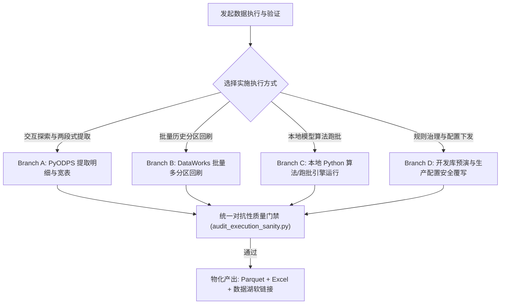

# 阶段四：数据分析执行与对账验证 (Analytics Data Execution & Verification)

负责数据方案的工程落地、算力调度与质量对账验证。统一调度 MaxCompute/PyODPS 底层交互、历史分区回刷、物理中间明细与汇总宽表提取、以及自动化对抗性单调性断言。

## 核心主导词 (Leading Words)

- **`【免Docker直跑 / pyodps-uv】`**：交互式轻量探索与快速查询统一采用 `uv run --with pyodps --no-project` 免 Docker 直跑，严格从 `~/.env` 读取数仓凭据。
- **`【中间表架构 / staging-table】`**：执行两段式提取，物化店品明细事实表（Parquet 列存）与门店汇总宽表，消除长 CTE 重复开销，支持秒级下钻排查。
- **`【对账门禁 / adversarial-gate】`**：模型与 SQL 计算产出后必须通过自动化断言门禁，严格核验行数唯一性、二元互斥守恒、金额自洽与 NULL 空值防卫。
- **`【数据湖外置 / lake-isolation】`**：全量二进制数据（Parquet/Excel）通过 `shared.data_lake` 存入外部数据湖并建立规范软链接，Markdown 报告直接留在仓库。

---

## 内部资产引用 (Internal Assets)

- **通用对账门禁脚本**：`scripts/audit_execution_sanity.py`（单调性、守恒性、有界性与空值断言 CLI）
- **数仓轻量探查脚本**：`scripts/odps_quick_probe.py`（分区与主键唯一性一键探查）
- **数据质量核验清单**：[references/DATA_QUALITY_CHECKLIST.md](references/DATA_QUALITY_CHECKLIST.md)
- **黄金执行与验证范例**：[examples/golden_execution_runner.py](examples/golden_execution_runner.py)
- **工程实施关联规范**：支持本地文件入仓（详见 [odps-table-ingest](../../product-strategy/odps-table-ingest/SKILL.md)）、批量多分区回刷（详见 [dataworks-yoy-backfill](../../product-strategy/dataworks-yoy-backfill/SKILL.md)）与策略规则治理（详见 [ps-reduction-scope-config-maintenance](../../product-strategy/ps-reduction-scope-config-maintenance/SKILL.md)）

---

## 4 大执行与验证分支 (Execution Branches)

### Branch A: PyODPS 交互拉取与两段式物化 (Query & Staging)
1. **加载环境与凭据**：严格读取 `~/.env`，复用 `shared.config.ODPSConfig` 与 `shared.odps_connector.ODPSConnector`；
2. **两段式物理提取**：
   - 第一段：提取店品明细事实层（`base_item_detail`），保存为 Parquet 文件，供排查具体品项动销；
   - 第二段：执行门店汇总层计算，输出标准宽表；
3. **安全数据湖外置**：调用 `shared.data_lake.export_topic_data` 输出 `.parquet` 与 `.xlsx`，仓库保留文本 `.md` 报告。

### Branch B: DataWorks 批量历史分区回刷 (Batch Backfill)
1. 构建单日 Multi-Table INSERT 语句，配置自然季度并发线程池；
2. 开启秒级跳过已存在分区机制，确保断点续跑。详见：[dataworks-yoy-backfill](../../product-strategy/dataworks-yoy-backfill/SKILL.md)。

### Branch C: 本地 Python 算法与模型脚本运行 (Python Analytics Engine)
执行阶段三设计的复杂计算与专项脚本：
1. **政策因果实证运行**：调用倾向得分匹配与双重差分 (DID) 求解器；
2. **专题宽表批量计算**：调用专题经单测验证的本地测算脚本（如 `calculate_new_store_metrics.py`）；
3. **大盘基准对齐核验**：调用外部参考与 MaxCompute 对齐校验工具（如 `verify_market_baseline.py`）。

### Branch D: 策略规则治理与安全覆写 (Rule Governance & Deploy)
1. 从用户需求确定规则变更范围与生效日期；
2. 在开发库 `dsl_analysis_dev` 执行验证与回读，确认无脏数据；
3. 将经验证的全量规则幂等覆写到生产正式配置表并回读校验。

---

## 执行步骤与对账门禁 (Steps & Verification Gates)

### Step 1: 环境与凭据加载 (Environment Loading)
严格从家目录 `~/.env` 读取凭据，复用 `product_strategy/shared` 设施，避免硬编码。

### Step 2: 执行数据提取与生成物理中间明细 (Data Extraction & Staging)
- 提取店品粒度明细数据集，保存为 `04_outputs/demand-<ID>-04-item-detail.parquet`；
- 提取门店汇总宽表数据集，保存为 `04_outputs/demand-<ID>-04-dataset.parquet` 与高管 Excel。

### Step 3: 执行对抗性质量门禁核验 (Adversarial Verification Gate ★)
运行 `scripts/audit_execution_sanity.py` 或内嵌门禁断言，严格核验 4 大指标：
1. **主键唯一性**：`COUNT(1) - COUNT(DISTINCT keys) == 0`，杜绝 Left Join 笛卡尔积膨胀；
2. **商品数二元互斥守恒**：`目录内在营商品数 + 目录外手工在营商品数 == 全店总在营商品数`（误差严格为 0）；
3. **金额全额流水自洽守恒**：`目录内销售额 + 目录外手工销售额 == 全店总销售额`（浮点误差 < 0.05元）；
4. **比率有界性与空值防卫**：所有执行率、动销率指标严格在 $[0, 100\%]$ 区间；未开考/无目录门店动销率严格保留为 NULL。

### Step 4: 物化交付物与质检报告输出 (Materialization & Report)
- 数据实体自动沉淀入外部数据湖并建立软链接；
- 运行数据湖边界检查命令断言合规；
- 输出现场质检监控 Markdown 报告：`04_outputs/demand-<ID>-04-sanity-report.md`，直接留存在仓库原位。
**完成标准**：数据文件通过全部门禁断言，外部数据湖软链接建立完毕，生成客观的质检监控 Markdown 报告。
