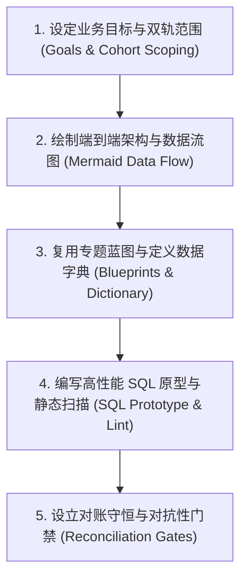

# 阶段三：数据方案 (Analytics Data Solution)

将阶段二锁定的业务口径、画像基准与分析指引沉淀为工程级 RFC 技术方案与生产级 SQL。设计系统拓扑、数据字典契约、高性能 SQL 原型、对账守恒门禁与对抗性校验规则。

## 核心主导词 (Leading Words)

- **`【方案规范 / rfc-spec】`**：技术方案采用结构化 RFC 格式，落盘在 `<project>/03_analysis/demand-<ID>-03-rfc.md` 与 SQL `<project>/03_analysis/sql/demand-<ID>-03-query.sql`。
- **`【专题方案库 / domain-blueprints】`**：按业务专题复用存量成熟设计规范（新店考核、O2O重点店Cohort、加盟店桑基指标、因果评估特征匹配），保持设计自洽。
- **`【双轨解耦 / cohort-decouple】`**：区分考核成熟样本与筹备期静态备货样本，独立适用评估模型，保护指标统计意义。
- **`【拓扑可视 / mermaid-first】`**：复杂多表关联、数据流转与淘汰逻辑使用 Mermaid 拓扑图完整呈现。
- **`【高效契约 / perf-sql-contract】`**：SQL 原型遵守 ODPS 性能规约，使用原生 `MAX_PT()`、前置聚合去重与中间宽表架构。
- **`【对账门禁 / reconciliation-gate】`**：方案内嵌对账守恒单元，确保商品数与销售流水二元互斥自洽成立。

---

## 内部资产引用 (Internal Assets)

- **性能扫描工具**：`scripts/odps_sql_linter.py`
- **规约手册**：
  - ODPS 性能优化规约：[references/ODPS_OPTIMIZATION_RULES.md](references/ODPS_OPTIMIZATION_RULES.md)
- 零漂移三段回归 SOP：[references/BATCH_ROLLOUT_REGRESSION_SOP.md](references/BATCH_ROLLOUT_REGRESSION_SOP.md)
- 陈列编码业务解构规约：[references/BUSINESS_DISPLAY_CODE_GRAMMAR.md](references/BUSINESS_DISPLAY_CODE_GRAMMAR.md)
- 空间组团吸附架构规范：[references/CLUSTER_SNAPPING_ARCHITECTURE.md](references/CLUSTER_SNAPPING_ARCHITECTURE.md)
  - RFC 技术方案模板：[templates/rfc_technical_design_template.md](templates/rfc_technical_design_template.md)
  - 标准对账 SQL 模板：[templates/sql_solution_template.sql](templates/sql_solution_template.sql)
  - 黄金技术方案范例：[examples/golden_rfc_technical_design.md](examples/golden_rfc_technical_design.md)
- **业务专题方案蓝图库 (Domain Solution Blueprints)**：
  阶段三涵盖多个商品策略方案专题，针对不同分析场景复用对应方案蓝图：
  - **新店与组货效果分析专题**：涵盖开业 90 天效益考核、下发到店漏斗、目录内外品效（单品销售/毛利）对比方案，详见内置契约 [new_store_benefit_metrics_contract.md](references/domain_blueprints/new_store_benefit_metrics_contract.md) 与 [ps-new-store-benefit-report](../../product-strategy/ps-new-store-benefit-report/SKILL.md)
  - **O2O 重点店/中心店专题**：同品池 Cohort 回溯与双优先级标签规则，详见内置契约 [o2o_store_benefit_reference.md](references/domain_blueprints/o2o_store_benefit_reference.md) 与 [o2o-store-benefit-report](../../product-strategy/o2o-store-benefit-report/SKILL.md)
  - **加盟店组货与桑基流专题**：21 项大盘基准指标与分类模型设计，详见内置契约 [franchise_market_baseline_contract.md](references/domain_blueprints/franchise_market_baseline_contract.md) 与 [ps-franchise-store-report](../../product-strategy/ps-franchise-store-report/SKILL.md)
  - **政策因果实证推断专题**：事前特征 1:N 匹配、尺度不变性 MDM 与 DID 模型设计，详见 [ps-causal-evaluation](../../product-strategy/ps-causal-evaluation/SKILL.md)
  - **策略规则治理专题**：商品剔除范围规则与生效配置变更设计，详见 [ps-reduction-scope-config-maintenance](../../product-strategy/ps-reduction-scope-config-maintenance/SKILL.md)
---

## 执行步骤与方案标准 (Steps)



### Step 1: 设定业务目标与双轨范围 (Goals & Cohort Scoping)
1. **Goals**：以 G1, G2, G3 显式列出可量化、可验证的核心目标（如：考核结束日截面指标聚合、单品日均产出与单品毛利对决、同期新店均线挂载）。
2. **双轨范围界定**：
   - 考核归因轨：跑完周期的成熟实体，输出执行率、动销率、全额流水与达成比；
   - 静态备货轨：筹备/试营业实体，重点输出目录铺货数、手工备货数与品类宽度，保持指标有效性。
3. **Non-Goals 与边界隔离**：明确本次方案不覆盖的边界与保护约束（如：不修改生产底表结构、不影响既有生产流水线）。
   - **试点特批台账 vs 全国系统底表边界隔离原则 (Pilot Ledger vs. System Master Boundary)**：
     当分析范围从试点区域扩展到全国大盘时，**明确隔离“局部实验特批台账”与“企业级系统档案”**。严禁将局部覆盖（如仅几十家试点店）的人工盘点表强行作为全国分母，必须以中台主档为唯一源头，并清晰披露口径差异。
### Step 2: 绘制端到端架构与数据流图 (Mermaid Data Flow)
使用 `flowchart TD` 呈现清晰的数据流动与计算层级：
- 输入层：基础事实表与维表全称，注明分区过滤规则；
- 计算层：样本分层、在营店品收敛、单品品效聚合；
- 门禁与交付层：对账断言节点与下游数据集产出。

### Step 3: 复用业务专题方案蓝图与定义数据字典 (Domain Blueprints & Data Dictionary)
1. **复用专题蓝图 (Domain Blueprints)**：
   根据需求所属业务域，直接调用内置蓝图库中已验证的成熟算式与字典规约（新店考核、O2O Cohort、加盟店桑基、因果匹配）。
2. **在营品效分母界定原则**：
   对于新店组货执行率与动销率，分母优先采用实际到店在营商品（如 1,700 余款），将因供应链断货/未到店的断流商品（如 300 余款）单列为履约缺损监控，保持货架指标与单品品效产出客观自洽。
3. **梳理数据字典契约 (Data Dictionary)**：
   完整建立字段映射表格，包括物理字段名、类型、标准中文列名与计算口径规则，消除命名歧义。

### Step 4: 编写高性能 SQL 原型并执行扫描 (SQL Prototype & Lint)
1. 遵守 MaxCompute 原生性能准则：
   - 优先建议使用考核结束日当天快照截面（契约对齐原生 `lt90_*_sum`），大幅精简跨日计算；
   - 强制使用原生宏或显式分区；
   - 关联前置聚合压平多版本；
   - **MaxCompute Grouping Sets 语法规约**：使用 `GROUPING SETS` 进行多级汇聚（公司/大区/营运区/门店）时，`GROUPING(col)` 及 `SELECT` 中出现的所有分组键，必须在主 `GROUP BY` 列清单中完整声明（如 `GROUP BY col_a, col_b, col_c GROUPING SETS ((), (col_a), (col_a, col_b), (col_a, col_b, col_c))`），避免报 `Argument should be a group by key` 语义异常；
   - 所有除法算式强制嵌套 `NULLIF(col, 0)` 实施除零防卫。
2. 运行本地扫描工具核验 SQL 原型：
   ```bash
   python3 scripts/odps_sql_linter.py <path/to/solution.sql>
   ```
   **完成标准**：静态检查结果为 `0 errors`。

### Step 5: 设立对账守恒与对抗性门禁 (Reconciliation & Adversarial Gates)
1. **二元互斥守恒断言**：在方案中制定阶段四必须跑过的对账检查：
   - `目录内在营商品数 + 目录外手工在营商品数 == 全店总在营商品数`（差值严格为 0）；
   - `目录内销售额 + 目录外手工销售额 == 全店总销售额`（浮点差 < 0.05元）。
2. **单调性与区间断言**：制定比率指标在 $[0, 100\%]$ 区间内的约束，无目录门店严格保留 NULL 语义。
3. **隔离与回滚机制**：分析方案以只读形式运行，若出现对账异常阻断下游物化，保护数据资产安全。

**完成标准**：在 `<project>/03_analysis/` 生成符合规范的 RFC 设计文档（`demand-<ID>-03-rfc.md`）与通过静态扫描的 SQL 方案文件（`sql/demand-<ID>-03-query.sql`）。
