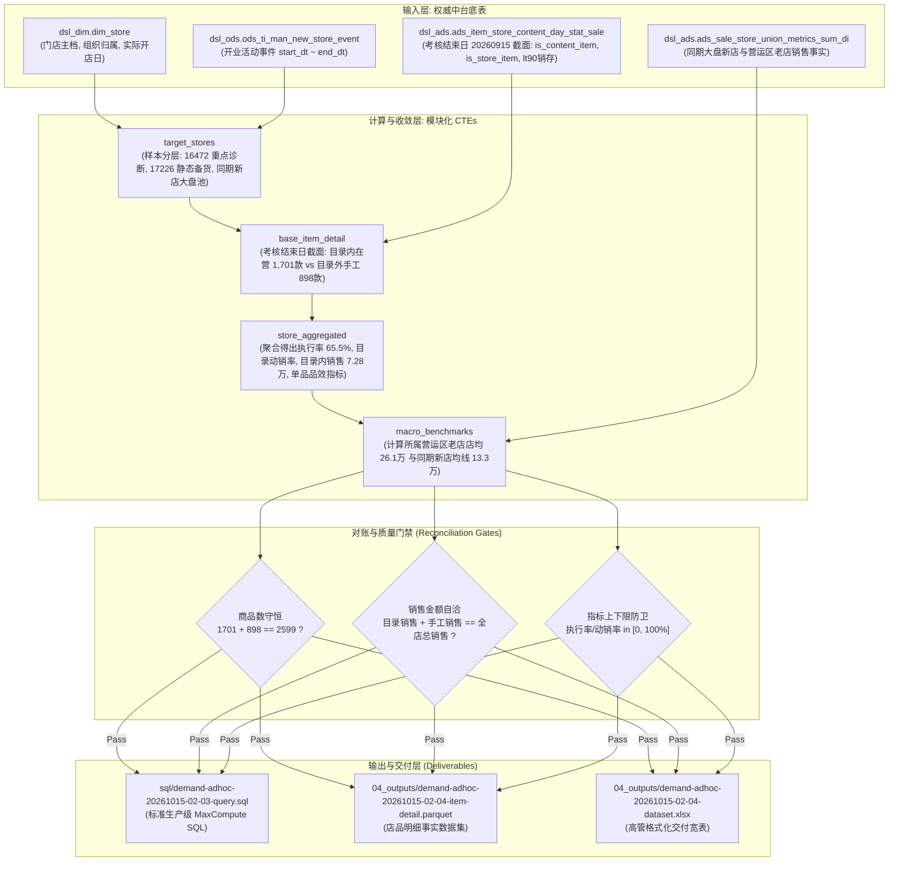

# 黄金范例：试点新店组货执行率与手工备货合理性评估 RFC 技术方案设计

---

## 1. 基础元数据 (Metadata)
- **方案编号**：`RFC-demand-adhoc-20261015-02-new-store-benefit`
- **需求单号 / 专题**：`demand-adhoc-20261015-02` / `topics/new_store/`
- **方案作者**：数据智能策略组
- **创建日期**：2026-10-16
- **口径输入源**：`topics/new_store/02_working_data/demand-adhoc-20261015-02-02-caliber.md`
- **执行状态**：`Approved`

---

## 2. 方案摘要与业务定位 (Executive Summary & Business Framing)
业务营运在阶段一反馈贺州 16472 门店开业 90 天仅卖 3 万元、桂林 17226 门店执行了大量区域手工备货，怀疑组货新店模型合理性。
经阶段二底层事实穿透核验：
1. **贺州 16472 说辞失真澄清**：真实 90 天考核流水为 **102,358.48 元**（非 3 万元，低估 3.4 倍），但达成率仅 52% 确实低迷；
2. **桂林 17226 错位澄清**：该店 10.22~10.26 始开业大促、10.27 始起算考核，当前仅处于试营业筹建期（2,900 元试机流水），不参与考核期横向对比。

本方案建立双轨分析架构：
- **轨道 A（综合效益与考核归因轨）**：面向 16472 贺州广场店及全区同期 52 家开业新店，以考核结束日截面计算目录执行率、动销率、全额真实流水及单品品效产出；
- **轨道 B（静态铺货结构诊断轨）**：面向 17226 桂林阳朔店，评估其 1,079 款目录品 vs 850 款手工自选品的静态铺货构成与货架宽度。

---

## 3. 目标与非目标 (Goals & Non-Goals)
### 3.1 目标 (Goals)
- **G1 (考核截面对齐)**：基于考核结束日截面（2026-09-15）提取组货目录事实，天然吻合 90 天考核时间窗口；
- **G2 (二元在营品效)**：目录内在营商品锁定为实际到店履约的 1,701 款，排除供应链未到货的 373 款断流品；手工在营锁定为 898 款，测算单品累计销售与单品毛利；
- **G3 (宏观双重视角)**：对比严格相同时间周期的“全区同期新店大盘均线 (13.3万)”与“贺州营运区成熟老店均线 (26.1万)”；
- **G4 (守恒与防卫门禁)**：商品数与销售金额二元互斥严格守恒，全量除法实施 `NULLIF(col, 0)` 除零防卫。

### 3.2 非目标 (Non-Goals)
- **NG1**：不将尚未进入考核期的 17226 桂林店销售额套入 90 天考核达成率模型；
- **NG2**：分析方案以只读形式运行，不修改数仓生产表结构，以本地 Parquet 与规范 Excel 物化交付。

---

## 4. 系统拓扑与数据流图 (Mermaid Data Flow)

---

## 5. 数据字典与字段映射契约 (Data Dictionary)

| 物理字段名 (`Field`) | 数据类型 (`Type`) | 中文字段名称 (`Chinese Name`) | 业务定义与计算口径规则 (`Rule`) |
| :--- | :--- | :--- | :--- |
| `region_man_code` | STRING | 营运区编码 | 核心聚合主键，避免同名冲突 |
| `region_man_name` | STRING | 营运区名称 | 营运区中文标准名称 |
| `store_code` | BIGINT | 门店编码 | 10位数字门店主键 |
| `store_name` | STRING | 门店名称 | 门店全称 |
| `store_cohort_label` | STRING | 门店分层 | 重点诊断: 贺州广场店 / 重点诊断: 桂林阳朔店 / 试点实验新店 / 同期对照新店 |
| `s_kh` | BIGINT | 考核开始日 | 活动结束日次日 (`end_dt + 1`)，使用 DATEADD 动态推导 |
| `e_kh` | BIGINT | 考核结束日 | `s_kh + 90` 天闭区间 |
| `catalog_sku_cnt` | BIGINT | 目录内在营商品数 | 目录内且实际到店在营商品数 (`is_content_item=1 AND is_store_item=1`，如 16472 为 1,701 款) |
| `manual_sku_cnt` | BIGINT | 目录外手工在营商品数 | 门店自选且在营商品数 (`is_content_item=0 AND is_store_item=1`，如 16472 为 898 款) |
| `total_on_sale_sku_cnt`| BIGINT | 全店总在营商品数 | 货架在营商品总数（守恒等于 `catalog_sku_cnt + manual_sku_cnt`，如 16472 为 2,599 款） |
| `execution_rate_pct` | DECIMAL(10,2) | 组货目录执行率_pct | `catalog_sku_cnt / NULLIF(total_on_sale_sku_cnt, 0) * 100` |
| `catalog_turnover_rate_pct` | DECIMAL(10,2) | 目录内商品动销率_pct | 目录内有销商品数 / `NULLIF(catalog_sku_cnt, 0) * 100` |
| `manual_turnover_rate_pct` | DECIMAL(10,2) | 目录外手工动销率_pct | 手工有销商品数 / `NULLIF(manual_sku_cnt, 0) * 100` |
| `overall_turnover_rate_pct` | DECIMAL(10,2) | 全店综合动销率_pct | 全店有销商品数 / `NULLIF(total_on_sale_sku_cnt, 0) * 100` |
| `catalog_sale_amt` | DECIMAL(18,2) | 目录内销售额_元 | 考核期内目录内商品 100% 真实销售流水（不打折，如 16472 为 72,848.50 元） |
| `manual_sale_amt` | DECIMAL(18,2) | 目录外手工销售额_元 | 考核期内手工商品 100% 真实销售流水（不打折，如 16472 为 17,304.15 元） |
| `total_sale_amt` | DECIMAL(18,2) | 全店总销售额_元 | 全店真实总流水（守恒等于 `catalog_sale_amt + manual_sale_amt`，如 16472 为 90,152.65 元） |
| `catalog_sale_ratio_pct` | DECIMAL(10,2) | 目录内销售贡献占比_pct | `catalog_sale_amt / NULLIF(total_sale_amt, 0) * 100` (如 16472 为 80.81%) |
| `catalog_per_item_sale` | DECIMAL(18,2) | 目录内单品累计销售_元_品 | `catalog_sale_amt / NULLIF(catalog_sku_cnt, 0)` (如 16472 为 42.83 元/品) |
| `manual_per_item_sale` | DECIMAL(18,2) | 目录外手工单品累计销售_元_品 | `manual_sale_amt / NULLIF(manual_sku_cnt, 0)` (如 16472 为 19.27 元/品) |
| `catalog_per_item_profit` | DECIMAL(18,2) | 目录内单品毛利贡献_元_品 | 目录内净毛利额 / `NULLIF(catalog_sku_cnt, 0)` (如 16472 为 12.44 元/品) |
| `manual_per_item_profit` | DECIMAL(18,2) | 目录外手工单品毛利贡献_元_品 | 手工净毛利额 / `NULLIF(manual_sku_cnt, 0)` (如 16472 为 5.21 元/品) |
| `region_avg_sale_amt` | DECIMAL(18,2) | 所属营运区老店平均销售_元 | 贺州营运区成熟老店考核同期店均销售（261,589.89 元） |
| `peer_avg_sale_amt` | DECIMAL(18,2) | 全区同期新店平均销售_元 | 广西同期开业新店大盘考核同期店均销售（133,134.24 元） |
| `region_ratio_pct` | DECIMAL(10,2) | 对比营运区老店达成比_pct | `total_sale_amt / NULLIF(region_avg_sale_amt, 0) * 100` |
| `peer_ratio_pct` | DECIMAL(10,2) | 对比同期新店达成比_pct | `total_sale_amt / NULLIF(peer_avg_sale_amt, 0) * 100` |

---

## 6. 对账守恒与对抗性门禁设计
1. **二元商品数守恒**：断言 `catalog_sku_cnt + manual_sku_cnt == total_on_sale_sku_cnt`（差值严格为 0）；
2. **销售金额自洽守恒**：断言 `catalog_sale_amt + manual_sale_amt == total_sale_amt`（浮点差 < 0.05 元）；
3. **指标上下限与除零防卫**：所有比率指标强制通过 $[0, 100\%]$ 检查，除法使用 `NULLIF(col, 0)` 拦截假阳性。
