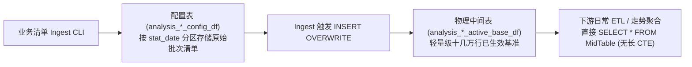

# 分批纳管、物理中间表加速与历史零漂移回归规约 (Batch Rollout Regression SOP)

当商品策略、缩铺退货、选品扩铺等数据分析涉及**算法定期测算**与**业务分批多波次执行**时，必须遵守以下工程架构与数据回归标准。

---

## 1. 批次双日期基准 (Dual-Date Batch Baseline)

当算法候选底表是周期性产出（如每周/每月测算），而业务下发的执行清单是分批次、分阶段启动时，必须严格解耦两个日期维度：

### 核心定义
- **测算基准日 (`rlt_stat_date`)**：算法宽表输出候选池与考核基准（如期初不动销总成本分母）的分区日期；
- **业务执行日 (`launch_date / batch_date`)**：业务实际下发门店执行下架/退仓的生效日期，用于控制库存走势在启动日前的截断；

### 反模式 (Bad Pattern)
```sql
-- 错误：用业务下发的执行日（如 2026-09-30）直接去关联算法考核分母表
LEFT JOIN dsl_analysis.analysis_store_item_all_stats_qty_di t0
  ON t0.stat_date = s.launch_date AND t0.store_code = s.store_code
```
- **后果**：大宽表通常仅在算法策略测算日有分区（如 20260922/20260928），直接用业务执行日关联会导致新批次门店分母全部为 NULL 或 0，引发占比为 NaN 或零漂移。

### 正确模式 (Best Practice)
```sql
-- 正确：分母严格按测算基准日 rlt_stat_date 关联，行级库存走势严格按 launch_date 截断门禁
LEFT JOIN dsl_analysis.analysis_store_item_all_stats_qty_di t0
  ON t0.stat_date = s.rlt_stat_date AND t0.store_code = s.store_code
```

---

## 2. 物理中间表加速与去 CTE 架构 (Materialized Base Table)

### 场景痛点
算法候选底表通常包含数千万至上亿行明细。若在下游日常 ETL、单日增量刷新、每日库存回填中重复书写：
```sql
WITH active_scope AS (...), base_rlt AS (...) -- 重复大表 Hash Join
```
会导致 ODPS 编译器多次对巨量底表做全表扫描与并发哈希关联，耗费大量计算资源且极易触发普通 JOIN 非等值错误。

### 标准架构：配置表 + 自动物化中间表



1. **配置表 (`analysis_..._config_df`)**：按 `stat_date` 分区存储业务下发的原始清单，保留省区、批次号、`rlt_stat_date`、`launch_date`、店码、品码、批号及金额；
2. **中间物理明细表 (`analysis_..._active_base_df`)**：仅包含当前所有有效店品批基准（几万~十几万行），结构包含：
   `(store_code, item_code, lot, st_qty, st_amt, batch_date, rlt_stat_date, prov_zone_man_nm, ret_amt)`；
3. **闭环刷新**：Ingest 脚本在每次完成新批次导入与 100% 核验后，自动触发对该中间物理表的 `INSERT OVERWRITE` 刷新；
4. **下游极速查询**：下游代码直接查中间物理表，彻底消灭所有 CTE 模板，单次查询时间从几分钟缩短至秒级。

---

## 3. 历史零漂移三段切片回归法 (Zero-Drift Three-Stage Slice)

重构底层底表、拆解 CTE 或新增批次后，必须在全量真实数据上执行三时点切片回归断言：

| 切片阶段 | 取样时点 | 验证目标与断言红线 |
|---|---|---|
| **T1: 历史纯净切片** | 取新批次均未启动的历史时间点（如旧批次运行中） | **100% 绝对守恒**：新代码输出的店数、品数、初始成本、期末成本、清理金额、分母、占比与历史官方数据完全零差异；新批次严格隔离在历史窗口外。 |
| **T2: 渐进过渡切片** | 取某新批次正式启动的当天 | **平滑接入**：该批次门店和品数平滑加入统计，其余尚未生效的省区与批次依然严格保持隔离。 |
| **T3: 当前全量切片** | 取最新数据日 | **全量达标**：所有已生效批次完整合并，总规模、累计金额与降幅完全吻合。 |

---

## 4. 看板契约与语义 Token 防御 (Dashboard Semantic Colors)

Marimo 等数据分析看板对设计契约有严格门禁：
1. **禁止硬编码 Hex 颜色**：严禁在 Notebook 脚本中出现 `#[0-9a-fA-F]{6}` 格式的颜色代码；
2. **多曲线动态映射**：采用语义 Token（`COLORS["primary"]`, `COLORS["accent"]`, `COLORS["success"]`, `COLORS["warning"]` 等）作为基础调色板，通过取模：
   ```python
   c = palette[idx % len(palette)]
   ```
   实现对未来任意 N 个省区/维度的动态渲染支持，既符合仓库契约，又具备自适应扩展能力。
