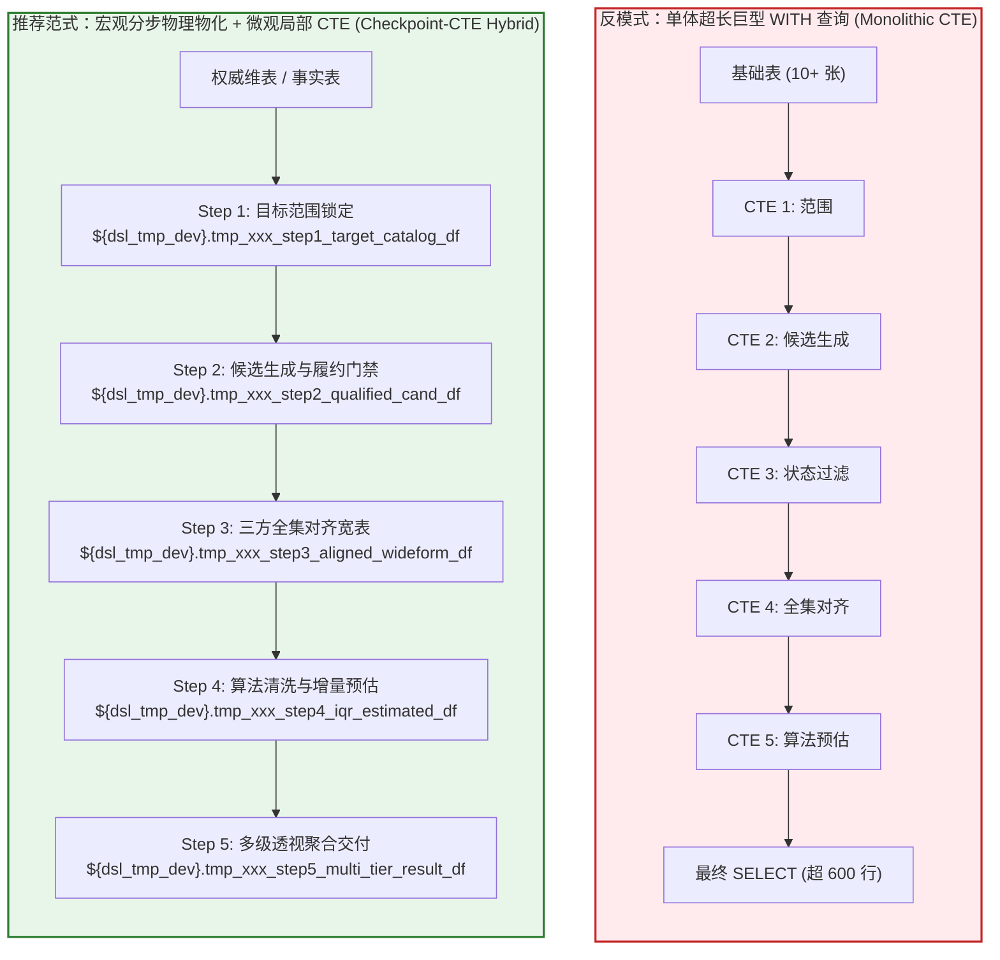

# MaxCompute 多阶段物理检查点与局部 CTE 架构规约 (Multi-Stage Checkpoint Spec)

在大规模数仓分析、商品智能组货与复杂跨期策略评估中，长链路 SQL 计算面临 DAG 依赖过深、执行计划倾斜、排查黑盒与全盘重跑高昂成本等系统性风险。本规约确立「宏观分步物理落盘 + 微观局部 CTE 模块化 + 全流程参数化 + 履约硬门禁前置」的标准架构。

---

## 核心主导词 (Leading Words)

- **`【分步物理物化 / checkpoint-cte-hybrid】`**：宏观上按业务阶段拆解为物理检查点（`DROP TABLE IF EXISTS ...; CREATE TABLE ... AS SELECT ...`），单表微观内部采用局部 CTE 模块化表达，根绝单体巨型 `WITH` 嵌套。
- **`【全参数化模板 / parameterized-template】`**：库名、业务快照日期、模型版本配置 100% 变量参数化（`${var_name}`），禁止一切硬编码，支持调度系统无缝部署与环境迁移。
- **`【开发安全隔离 / dev-staging-isolation】`**：中间物理物化表 100% 写入 `${dsl_tmp_dev}` 开发临时库，使用 `tmp_<topic|demand>_*` 唯一前缀，支持事后单键清理，严禁写入或残留生产 ADS 库。
- **`【前置履约门禁 / fulfillment-pregate】`**：增补候选生成阶段强关联仓库/门店状态表，执行仓库状态非异常、非无条码、门店经营范围正常等多级物理可履约门禁，防止“纸面增补、实际断供”。

---

## 一、架构拓扑对比 (Architecture Topology)

### 1. 拓扑结构对照



### 2. 核心特性对比矩阵

| 评估维度 | 单体巨型 WITH 嵌套 (Anti-Pattern) | 物理检查点物化 + 局部 CTE (Best Practice) |
| :--- | :--- | :--- |
| **MaxCompute 执行计划** | DAG 过于庞大，易引发 CBO 优化器内存溢出与算子倾斜 | 分阶段编译与调度，执行计划扁平透明，各阶段优化隔离 |
| **异常排查与故障定位** | 报语法/类型错误或数据倾斜时，堆栈为黑盒，需人工逐段拆解排查 | 单步检查点已物理落盘，直接执行 `SELECT ...` 探针秒级定界 |
| **失败恢复与算力成本** | 链路后段出错必须全盘从头重跑，消耗数倍集群算力与等待时长 | 支持断点续跑（Checkpointing），仅从失败步骤向后执行 |
| **代码可读性与模块化** | 数百行 `WITH a AS (), b AS ()` 链条上下文纠缠，认知负荷极高 | 5 大业务阶段边界清晰，单表内微观 CTE 仅服务于本步局部逻辑 |
| **生产调度稳定性** | 易因单表锁超时或单一资源瓶颈导致整段任务挂起 | 阶段解耦，内存与落盘开销均匀分摊，调度平稳可控 |

---

## 二、四大设计规约 (Core Design Specifications)

### 1. 宏观物理物化 vs 微观局部 CTE (Checkpoint-CTE Hybrid)

- **阶段拆分基准 (The 5-Step Checkpoint Standard)**：
  - **Step 1 (基准范围锁定)**：锁定试点实体（门店/品类）与存量基准目录，完成维度属性对齐；
  - **Step 2 (候选生成与履约门禁)**：计算模型缺口/增补候选，前置过滤履约状态，执行主键开窗截断；
  - **Step 3 (三方全集对齐宽表)**：基于 `FULL OUTER JOIN` 合并基准目录、模型候选与观察日事实，打齐原子布尔标记；
  - **Step 4 (算法清洗与增量预估)**：运行同质组群统计（如双侧 IQR 清洗均值），为未在营缺口注入保守增量；
  - **Step 5 (多维透视与对账产出)**：使用 `GROUPING SETS` 单次输出大盘与细分维度看板指标。
- **微观局部 CTE 规范**：每个 `CREATE TABLE AS` 内部仅声明本阶段所必需的中间 CTE，禁止跨阶段引用；单表写入完成即刻释放局部命名空间。

### 2. 全流程参数化模板 (Parameterized Templates)

杜绝在 SQL 中硬编码库名、业务日期与配置主键。统一声明并注入以下参数变量：

```sql
-- 库名变量参数化
${dsl_tmp_dev}      -- 开发临时库（中间表唯一写入地）
${dsl_ads}          -- 生产 ADS 宽表/结果库
${dsl_dim}          -- 主数据维表库
${dsl_dwd}          -- 明细事实库
${dsl_dws}          -- 汇总事实库

-- 快照日期与业务周期
${benchmark_date}   -- 策略生成/基准快照日期（如 20260814）
${observation_date} -- 经营事实观察快照日期（如 20261028）

-- 业务配置与策略版本号
${config_id}        -- 配置模板主键（如 10026）
${version_id}       -- 组货目录/策略版本号（如 10026）
${scope_type}       -- 组货模型范围类型（如 5 为补充主推，6 为 TOP 品种补全）
```

### 3. 开发安全隔离与临时表清理 (Dev Staging Isolation & Cleanup)

- **唯一落地目标**：所有中间计算表、断点探针表必须且只能写入 `${dsl_tmp_dev}` 临时库。
- **命名空间规范**：物理临时表命名必须遵循 `tmp_<demand_id>_<step_number>_<entity>_df`（例如 `tmp_32014b_step1_target_catalog_df`），杜绝跨需求同名覆盖。
- **严禁污染生产库**：严禁向生产 ADS 库写入任何 `tmp_*` 前缀表；交付表写入生产库必须具备幂等分区或版本管理。
- **执行清理 SOP**：作业完成或验收归档后，提供或执行一键清理语句：
  ```sql
  DROP TABLE IF EXISTS ${dsl_tmp_dev}.tmp_32014b_step1_target_catalog_df;
  DROP TABLE IF EXISTS ${dsl_tmp_dev}.tmp_32014b_step2_qualified_cand_df;
  DROP TABLE IF EXISTS ${dsl_tmp_dev}.tmp_32014b_step3_aligned_wideform_df;
  DROP TABLE IF EXISTS ${dsl_tmp_dev}.tmp_32014b_step4_iqr_estimated_df;
  DROP TABLE IF EXISTS ${dsl_tmp_dev}.tmp_32014b_step5_multi_tier_result_df;
  ```

### 4. 增补品前置履约门禁 (Fulfillment Pre-Gates)

策略增补品不能仅基于销售端热度或理论缺口判定，必须在 **Step 2 候选生成阶段** 强关联仓储与门店状态权威表（`ads_item_3he1_db_1_6_sale_store_item_status`），执行 12 项前置可供门禁：

```sql
warehouse_status_gate AS (
    SELECT store_code, item_code
    FROM ${dsl_ads}.ads_item_3he1_db_1_6_sale_store_item_status
    WHERE stat_date = ${benchmark_date}
      AND is_wh_itme_status_yc = 0        -- 门禁 1：仓库商品状态非异常
      AND is_wh_wtm = 0                   -- 门禁 2：仓库非无条码
      AND is_store_jyfwyc = 0             -- 门店 3：门店经营范围正常
      AND is_store_item_tc = 0            -- 门店 4：门店非剔除品
      AND is_store_dept_tc = 0            -- 门店 5：门店中类非剔除
      AND is_yyq_item_tc = 0              -- 区域 6：营运区非剔除品
      AND is_yyq_dept_tc = 0              -- 区域 7：营运区中类非剔除
      AND is_store_group_tc = 0           -- 组群 8：门店组群非剔除
      AND is_jjx_varieties_tc = 0         -- 品种 9：非基药品种剔除
      AND is_push_class_yc = 0            -- 属性 10：非主推级别异常
      AND is_div_tc = 0 AND is_djp_tc = 0 -- 属性 11：非部类/大件品剔除
      AND COALESCE(push_class, 'A') NOT IN ('DS') -- 属性 12：排除停产/淘汰标签
)
```

---

## 三、标准 SQL 骨架与检查点范例 (Standard SQL Scaffold)

全文已拆分至姊妹文件：[MAXCOMPUTE_CHECKPOINT_SQL_SCAFFOLD.md](./MAXCOMPUTE_CHECKPOINT_SQL_SCAFFOLD.md)（含物理检查点 1-N 的标准 SQL 骨架与检查点范例）。

---


## 四、分步物理检查点排查口径与验证清单 (Checkpoint Diagnostics)

每个物理检查点落盘后，必须使用独立的探针 SQL 校验其行数、去重主键与守恒闭环：

| 检查点阶段 | 物理落盘表名 | 核心对账口径与断言 | 单步就地探针排查 SQL | 失败告警与排查动作 |
| :--- | :--- | :--- | :--- | :--- |
| **Step 1** | `tmp_32014b_step1_target_catalog_df` | 门店覆盖率与基准目录一致；`store_code + item_code` 0 重复 | `SELECT COUNT(1) AS total, COUNT(DISTINCT store_code, item_code) AS pk_cnt FROM ${dsl_tmp_dev}.tmp_32014b_step1_target_catalog_df;` | `total != pk_cnt`：检查上游 `version_id` 是否混入了多批次更新 |
| **Step 2** | `tmp_32014b_step2_qualified_cand_df` | 候选集严格在缺口品种内；主键严格唯一；12 项门禁 0 穿透 | `SELECT COUNT(1) AS total_cand, COUNT(DISTINCT store_code, item_code) AS pk_cnt FROM ${dsl_tmp_dev}.tmp_32014b_step2_qualified_cand_df;` | 出现单店同品种多品：检查 `ROW_NUMBER()` 开窗是否漏掉 `store_code` |
| **Step 3** | `tmp_32014b_step3_aligned_wideform_df` | 三方全集闭环：`in_cand+in_catalog+in_facts` 组合全覆盖；缺失事实保留 NULL | `SELECT in_cand, in_catalog, in_facts, is_pure_add_push, COUNT(1) FROM ${dsl_tmp_dev}.tmp_32014b_step3_aligned_wideform_df GROUP BY in_cand, in_catalog, in_facts, is_pure_add_push;` | 出现 `in_cand=0 AND in_catalog=0 AND in_facts=0`：排查三方 FULL JOIN 是否出现孤儿键或关联字段空值漂移 |
| **Step 4** | `tmp_32014b_step4_iqr_estimated_df` | 预估注入严格限定 `is_pure_add_push=1 AND is_store_item=0`；在营实绩 0 覆盖 | `SELECT COUNT(1) FROM ${dsl_tmp_dev}.tmp_32014b_step4_iqr_estimated_df WHERE is_store_item = 1 AND estimated_sale_amt > 0;` | 计数 `> 0`：逻辑穿透，在营商品被误注入预估金额，需检查注入门禁条件 |
| **Step 5** | `tmp_32014b_step5_multi_tier_result_df` | 多级聚合销售额与分项加总守恒；动销率在 `[0, 100%]` 区间 | `SELECT top_tier, push_class, store_cnt, catalog_sku_cnt, catalog_sales_amt FROM ${dsl_tmp_dev}.tmp_32014b_step5_multi_tier_result_df;` | 店均商品数突变：排查 `store_cnt` 是否由 `COUNT(DISTINCT)` 正确产出 |

---

## 五、完成标准 (Completion Criteria)

1. **零单体超长 WITH 依赖**：作业全流程由离散物理中间表解耦，任何单步失败均可在 10 秒内直接定位故障表。
2. **零硬编码**：脚本内无任何写死的库名、日期分区或配置 ID，全部由上层调度注入。
3. **100% 开发库隔离**：中间表全部位于 `${dsl_tmp_dev}`，经 `SHOW TABLES LIKE 'tmp_*'` 校验且生产 ADS 库 0 残留。
4. **履约门禁 100% 拦截**：候选池内 `is_wh_itme_status_yc = 1` 或 `is_wh_wtm = 1` 的记录数严格等于 0。
