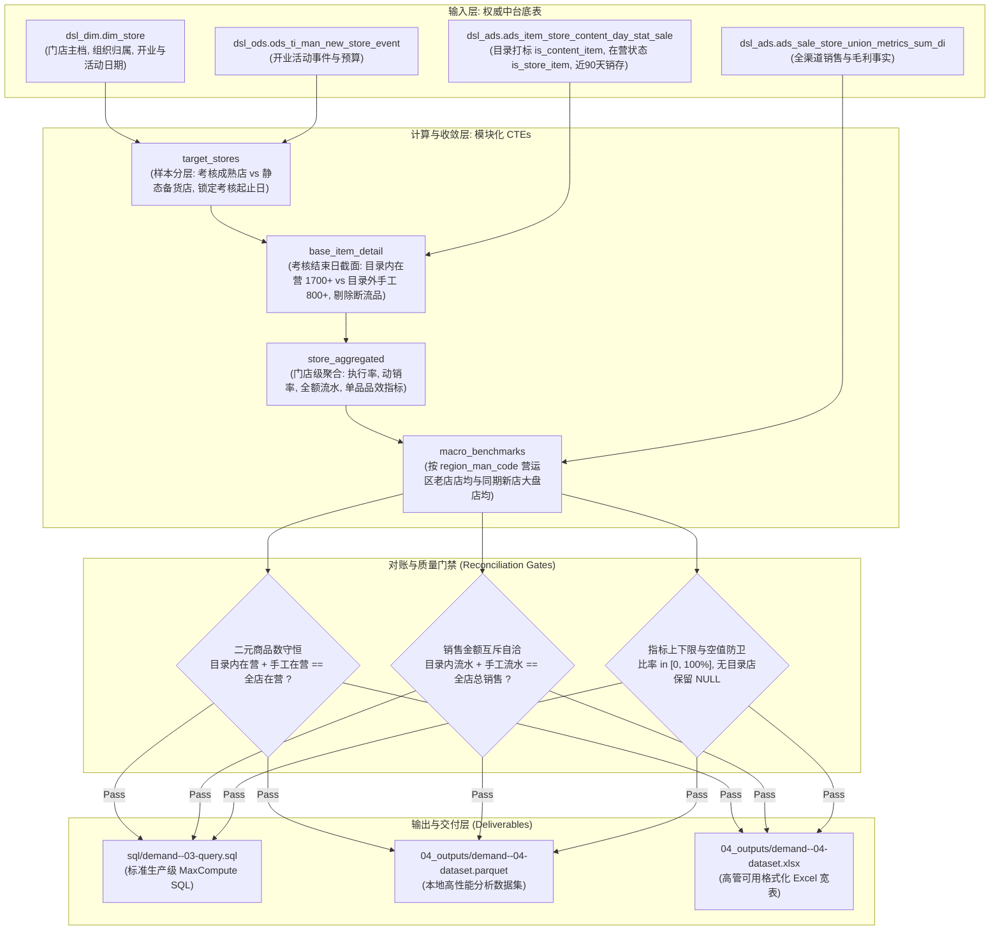

# RFC 技术方案设计规范模板 (Technical RFC Specification Template)

---

## 1. 基础元数据 (Metadata)
- **方案编号**：`RFC-[demand_id]-[topic_slug]`
- **需求单号 / 专题**：`[demand_id]` / `topics/<topic_id>/`
- **方案作者**：`[Author / Analytics Engineer]`
- **创建日期**：`[YYYY-MM-DD]`
- **口径输入源**：`topics/<topic_id>/02_working_data/demand-<ID>-02-caliber.md`
- **执行状态**：`Draft | Review | Approved`

---

## 2. 方案摘要与业务定位 (Executive Summary & Business Framing)
- **业务背景与客体**：`[阐明分析实体与触发背景]`
- **阶段二核心发现承接**：`[承接阶段二业务说辞复现结果，指出真伪与真实核心症结]`
- **双轨分析定位**：
  - **考核与效益分析轨**：面向已完整跑完考核周期的成熟样本，评估目录执行率、品效产出与大盘达成比；
  - **静态备货诊断轨**：面向尚未开始考核的筹备期样本，诊断静态商品目录铺货与货架宽度构成。

---

## 3. 目标与非目标 (Goals & Non-Goals)
### 3.1 目标 (Goals)
- **G1 (计算目标)**：以考核结束日截面（或动态起止日）为基准，产出目录内、目录外手工与全店的品项数、动销数、动销率、销售额、毛利额；
- **G2 (品效对决)**：计算目录内外的单品累计销售、单品日均流水与单品毛利贡献，量化单位货架吸金力与净赚力差异；
- **G3 (宏观对齐)**：挂载严格相同时间周期的“同期开业新店大盘均线”与“所属营运区成熟老店均线”双重视角；
- **G4 (工程质量)**：落实 Left Join 防膨胀、全量除法除零防卫，静态代码检查 0 errors。

### 3.2 非目标 (Non-Goals)
- **NG1**：不将尚未开业/尚未进入考核期的筹备样本强行套入考核达成率模型；
- **NG2**：分析方案以只读形式运行，不修改数仓生产表结构，不破坏历史已有分区。

---

## 4. 系统拓扑与数据流图 (Mermaid Data Flow)

---

## 5. 数据字典与字段映射契约 (Data Dictionary)

严格遵循标准字段命名，杜绝同义不同名或指标漂移：

| 物理字段名 (`Field`) | 数据类型 (`Type`) | 中文字段名称 (`Chinese Name`) | 业务定义与计算口径规则 (`Rule`) |
| :--- | :--- | :--- | :--- |
| `region_man_code` | STRING | 营运区编码 | 核心聚合主键，避免同名歧义 |
| `region_man_name` | STRING | 营运区名称 | 营运区中文标准名称 |
| `store_code` | BIGINT | 门店编码 | 10位数字门店主键 |
| `store_name` | STRING | 门店名称 | 门店全称 |
| `store_cohort_label` | STRING | 门店分层 | 重点诊断店 / 试点实验新店 / 同期对照新店 |
| `s_kh` | BIGINT | 考核开始日 | 活动结束日次日 (`end_dt + 1`)，使用 DATEADD 动态推导 |
| `e_kh` | BIGINT | 考核结束日 | `s_kh + 90` 天闭区间 |
| `catalog_sku_cnt` | BIGINT | 目录内在营商品数 | 目录内且实际在营的商品数 (`is_content_item=1 AND is_store_item=1`)，排除供应链未到货断流品 |
| `manual_sku_cnt` | BIGINT | 目录外手工在营商品数 | 门店自选且在营商品数 (`is_content_item=0 AND is_store_item=1`) |
| `total_on_sale_sku_cnt`| BIGINT | 全店总在营商品数 | 货架在营商品总数（守恒等于 `catalog_sku_cnt + manual_sku_cnt`） |
| `execution_rate_pct` | DECIMAL(10,2) | 组货目录执行率_pct | `catalog_sku_cnt / NULLIF(total_on_sale_sku_cnt, 0) * 100` |
| `catalog_turnover_rate_pct` | DECIMAL(10,2) | 目录内商品动销率_pct | 目录内有销商品数 / `NULLIF(catalog_sku_cnt, 0) * 100`（无目录店显示为 NULL） |
| `manual_turnover_rate_pct` | DECIMAL(10,2) | 目录外手工动销率_pct | 手工有销商品数 / `NULLIF(manual_sku_cnt, 0) * 100` |
| `overall_turnover_rate_pct` | DECIMAL(10,2) | 全店综合动销率_pct | 全店有销商品数 / `NULLIF(total_on_sale_sku_cnt, 0) * 100` |
| `catalog_sale_amt` | DECIMAL(18,2) | 目录内销售额_元 | 考核期内目录内商品 100% 真实销售流水（不打折） |
| `manual_sale_amt` | DECIMAL(18,2) | 目录外手工销售额_元 | 考核期内手工商品 100% 真实销售流水（不打折） |
| `total_sale_amt` | DECIMAL(18,2) | 全店总销售额_元 | 全店真实总流水（守恒等于 `catalog_sale_amt + manual_sale_amt`） |
| `catalog_sale_ratio_pct` | DECIMAL(10,2) | 目录内销售贡献占比_pct | `catalog_sale_amt / NULLIF(total_sale_amt, 0) * 100` |
| `catalog_per_item_sale` | DECIMAL(18,2) | 目录内单品累计销售_元_品 | `catalog_sale_amt / NULLIF(catalog_sku_cnt, 0)`，衡量目录单品吸金力 |
| `manual_per_item_sale` | DECIMAL(18,2) | 目录外手工单品累计销售_元_品 | `manual_sale_amt / NULLIF(manual_sku_cnt, 0)`，衡量手工单品吸金力 |
| `catalog_per_item_profit` | DECIMAL(18,2) | 目录内单品毛利贡献_元_品 | 目录内净毛利额 / `NULLIF(catalog_sku_cnt, 0)`，衡量目录单品净赚力 |
| `manual_per_item_profit` | DECIMAL(18,2) | 目录外手工单品毛利贡献_元_品 | 手工净毛利额 / `NULLIF(manual_sku_cnt, 0)`，衡量手工单品净赚力 |
| `region_avg_sale_amt` | DECIMAL(18,2) | 所属营运区老店平均销售_元 | `AVG(total_sale_amt) OVER(PARTITION BY region_man_code)` 区域老店店均 |
| `peer_avg_sale_amt` | DECIMAL(18,2) | 全区同期新店平均销售_元 | 全区同期开业新店大盘平均销售基准线 |
| `region_ratio_pct` | DECIMAL(10,2) | 对比营运区老店达成比_pct | `total_sale_amt / NULLIF(region_avg_sale_amt, 0) * 100` |
| `peer_ratio_pct` | DECIMAL(10,2) | 对比同期新店达成比_pct | `total_sale_amt / NULLIF(peer_avg_sale_amt, 0) * 100` |

---

## 6. 高性能 SQL 原型开发规范
1. **静态分区裁剪**：全面使用 `stat_date = MAX_PT('table')` 或指定考核截面日 `stat_date = 20260915`，严禁标量子查询；
2. **前置聚合去重**：涉及多版本表在关联主表前统一执行 `GROUP BY store_code, item_code` 压平版本；
3. **除零严格防卫**：所有除法算式强制使用 `NULLIF(分母, 0)` 保护，杜绝除零溢出与伪假阳性。

---

## 7. 质量守恒与对抗性门禁 (Quality Gates)
1. **商品数守恒门禁**：断言 `catalog_sku_cnt + manual_sku_cnt == total_on_sale_sku_cnt`（差值严格为 0）；
2. **金额自洽守恒门禁**：断言 `catalog_sale_amt + manual_sale_amt == total_sale_amt`（浮点差 < 0.05 元）；
3. **比率区间门禁**：所有比率指标强制通过 $[0, 100\%]$ 有效区间检查；
4. **空值与零语义断言**：无目录门店动销率严格为 `NULL`，保留未下发目录的客观真实语义。
