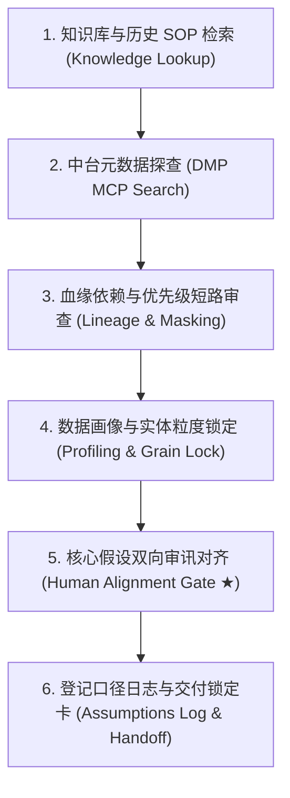

# 阶段二：需求分析 (Analytics Demand Analysis)

基于阶段一归档的需求，通过企业内部知识库检索、中台元数据探查、表级血缘追踪与数据画像，锁定业务实体计算粒度与真实口径。

## 核心主导词 (Leading Words)

- **`【双向对齐 / human-align】`**：口径不可凭空臆测，必须与业务方显式交互审讯，就时间窗口、排除边界、分母定义、对照组达成共识后方可落盘。
- **`【粒度锁定 / profile-grain】`**：主键与实体粒度是分析基石，前置断言 `COUNT(1) - COUNT(DISTINCT keys) == 0`。
- **`【元数探查 / dmp-lookup】`**：中台物理表探查通过 DMP MCP 关键词检索与字段注释反查，以客观数据字典为准。
- **`【掩盖排查 / masking-audit】`**：涉及打标字段（如 `reason_fl`、`scope_type`）时，反查生成 SQL 的 `CASE WHEN` 顺位，保护兼具多重正当属性的业务记录。
- **`【基准画像 / baseline-grounded】`**：源数据提取 6 项基准指标（行数、门店数、商品数、主键数、数量总和、金额总和），建立全流程守恒对照线。
---

## 内部资产引用 (Internal Assets)
- 元数据检索脚本：`scripts/dmp_mcp_client.py`
- 血缘链路追踪：`scripts/dataworks_lineage.py`
- 粒度与质量清单：[references/profiling_checklist.md](references/profiling_checklist.md)
- 优先级掩盖排查：[references/MULTI_MODEL_MASKING_AUDIT.md](references/MULTI_MODEL_MASKING_AUDIT.md)
- 分析口径假设日志：[references/analysis_assumptions_log.md](references/analysis_assumptions_log.md)
- 口径锁定模板：[templates/caliber_lock_template.md](templates/caliber_lock_template.md)
- 黄金基准范例：[examples/golden_profiling_and_caliber_lock.md](examples/golden_profiling_and_caliber_lock.md)
---

## 执行步骤与完成标准 (Steps)


### Step 1: 专题内生资产调研与知识库检索 (Topic Context & Knowledge Lookup ★)
**硬性规范**：严禁无视当前专题既有资产直接重新造轮子。分析师/Agent 开展分析前，必须首先全景扫描并利用当前专题（如 `topics/<topic_id>/`）内沉淀的存量资产：
1. **业务策略与口径上下文 (`00_context/`)**：
   - 深入阅读业务 PRD、口径说明与归因 Playbook（例如：`new_store_assessment_vs_catalog_sales_analysis.md` 中的多阶段流水拆解与穿透 SQL 模版、`new_store_process_dt.md` 中的 Hologres/MaxCompute 原生考核口径）。
2. **存量生产脚本与测算引擎 (`03_analysis/scripts/` & `03_analysis/sql/`)**：
   - 审查专题内既有的 Python 测算与对账脚本（如 `verify_new_store_assessment.py`、`calculate_new_store_metrics.py`），复用其中已通过单测验证的字段映射、单调性校验和核心公式，避免重复发明相互冲突的代码逻辑。
   - 审查既有 SQL 方案（如 `new_store_benefit_analysis.sql`），提取权威数仓物理表名、过滤分区与历史关联逻辑。
3. **历史交付物与基线结论 (`README.md`, `04_outputs/`, `05_delivery/`)**：
   - 核对当前专题记录的历史达标门店、分层基线与指标防漂移契约（如 32 项标准中文字段定义、O2O 折算 1/3 规则），确保本次分析承前启后、口径一致。
### Step 2: 中台元数据探查 (DMP MCP Search)
1. 调用本地 DMP MCP 客户端搜索中台物理表：
   ```bash
   python3 scripts/dmp_mcp_client.py search "<业务关键词，如统筹/新店/加盟>" --top 5
   ```
2. 深入探查表结构与字段注释：
   ```bash
   python3 scripts/dmp_mcp_client.py detail <表名> --filter <字段关键词>
   ```
**完成标准**：锁定本次分析依赖的 1~3 张核心事实表与维表物理全称，并记录其有效业务分区。

### Step 3: 血缘依赖与优先级短路审查 (Lineage & Masking Audit)
1. **血缘链路追踪**：
   ```bash
   python3 scripts/dataworks_lineage.py --table <目标表> --direction up --depth 2
   ```
2. **多模型优先级掩盖排查**：
   审查上游生产 SQL 中的 `CASE WHEN` 逻辑，排查高顺位规则是否短路低顺位标志位。
   参考指南：[references/MULTI_MODEL_MASKING_AUDIT.md](references/MULTI_MODEL_MASKING_AUDIT.md)。
**完成标准**：完成上下游血缘判定，运用纯净集隔离逻辑保持业务规则短路顺序清晰。

### Step 4: 数据画像与实体粒度锁定 (Profiling & Grain Lock)
1. **阶段一业务说辞复现与去伪存真 (Fact Verification)**：
   严格使用数仓只读底表复现业务方提出的核心口头数字或业务假设，验证其真实性。若前提失真（如数字低估数倍、周期错位），优先指出口径偏差，防止后续分析建立在错误假设之上。
2. **明确核心指标算法与业务理由 (Metrics Rationales)**：
   明确各分析指标（如时间窗口切分、执行率、动销率、全额真实流水、近90天默认聚合口径）的算式，并陈述业务与统计学理由，确保指标自洽。
3. **纵向生命周期画像 (Longitudinal Profile)**：
   拆解目标实体在开业活动大促期、正式考核期及后续日常期的销售、毛利、客流与客单价演变，识别经营阶段特征。
4. **横向严格相同周期大盘基准对比 (Cross-Sectional Benchmark)**：
   所有对比对象（目标新店、同期开业新店大盘均线、区域成熟老店均线）必须**严格对齐在完全一致的日期闭区间**内，消除时间差异，真实衡量其实际经营能力。

### Step 5: 核心口径假设双向审讯对齐 (Human Alignment Gate ★ 关键防线)
**硬性约束**：严禁分析师/Agent 单向脑补口径直接进入方案。在完成事实复现与横纵画像后，向业务负责人/用户发起交互审讯确认，覆盖 4 大核心定性：
1. **时间窗口定性**：开业活动期是否剥离、动态考核天数起止规则；
2. **分母边界定性**：仓缺断货是否剔除、有库存 vs 在营状态判定；
3. **指标门禁定性**：动销率有效门槛（如纯有销售 vs 在架天数限制）；
4. **对照组基准定性**：同商圈老店 vs 同期全区新店大盘平均。

### Step 6: 登记口径日志与交付锁定卡 (Assumptions Log & Stage 3 Handoff)
1. **显式登记分析口径假设日志**：
   将与业务/用户确认的口径定性逐条记录至 `topics/<topic_id>/02_working_data/demand-<ID>-02-assumptions.md`。
   参考规约：[references/analysis_assumptions_log.md](references/analysis_assumptions_log.md)。
2. **交付口径锁定卡 (Caliber Lock Report)**：
   将分析结果按 [templates/caliber_lock_template.md](templates/caliber_lock_template.md) 输出至专题 `topics/<topic_id>/02_working_data/demand-<ID>-02-caliber.md`，包含 5 大核心模块：
   - **1. 业务说辞真实性复现与核验**（客观数字复现与偏差归因）；
   - **2. 核心指标算法与业务理由**（算式定义与统计学依据）；
   - **3. 纵向生命周期流水拆解**（大促期 vs 考核期 vs 日常期演变）；
   - **4. 横向严格相同周期大盘基准对比**（目标店 vs 同期新店均线 vs 成熟老店均线）；
   - **5. 阶段三分析方向与设计指引**（基于前四部分总结建模原则、截面基准日选定建议与样本适用性，避免硬编码断言）。
