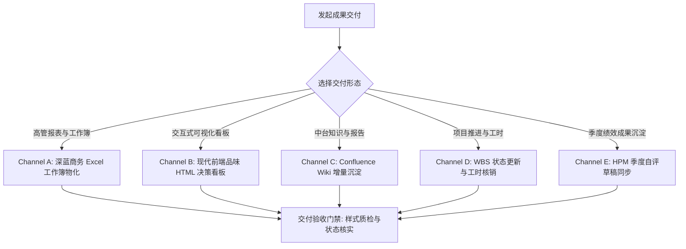

# 阶段五：结果交付与协同闭环 (Analytics Result Delivery)

负责数据分析成果的多渠道物化、可视化呈现与协同闭环。涵盖高管 Excel 工作簿、基于前端设计规范（`design-taste-frontend`）的交互式 HTML 看板、Confluence Wiki 知识沉淀、WBS 进度回写与工时闭环。

## 核心主导词 (Leading Words)

- **`【高管工作簿 / executive-excel】`**：Excel 交付达到直接呈报标准（深蓝底白字表头居中、自适应列宽、数值带千分位、比率严格应用百分比格式）。
- **`【设计品味 / design-taste-html】`**：利用 HTML/现代前端规范呈现分析报告，遵循“总-分-总”结构，背景、结论、过程数据证据链完备，排版考究、层次分明、拒绝模板化。
- **`【知识增量 / wiki-sync】`**：Wiki 文档发布遵循增量版本追加原则，保持历史版本与附件完整。
- **`【工时与协同 / timesheet-audit】`**：工时填报与需求结单基于真实 Git 提交与需求编号交叉比对，整周工时严格守恒。
- **`【双模交付与用语去黑话 / humanized-delivery】`**：交付成果保持 Markdown 报告与高管 HTML 看板双模落盘；正文严格调用 `/skill:humanizer-zh` 去除 AI 腔调与工程黑话（如以“陈列架总长度”取代“延米”），写出自然、直接、有立场的业务决策语言。
- **`【命名空间契约 / scoped-delivery-naming】`**：阶段五交付文件严格采用 `topics/<topic_id>/05_delivery/md/demand-<adhoc|id>-<topic_id>-<datehour>-05-delivery.md` 与同名 `.html` 命名。
- **`【同名幂等覆盖与资产继承 / idempotent-asset-overwrite】`**：同一数据交付物坚持稳定命名，继承既有物理文件名，严禁私起 `_v1`/`_v2`/`_fixed` 别名。新版本经临时产物门禁断言通过后同名原子覆盖，保持数据湖物理实体与仓库软链接稳定有效。
- **`【阶段六复盘询问 / postmortem-inquiry】`**：成果交付结单后，先询问用户是否需要复盘；用户明确同意（或当前会话已明确授权）后才在 `topics/<topic_id>/06_decisions/` 物化三段式决策复盘卡，未经同意不默认生成。复盘严禁事后篡改交付口径。
- **`【先读责任书 / source-first】`**：HPM 的指标名称、指标类型、权重、档位选项与目标值以在线责任书为唯一真源；动笔前先读出并逐项照录。
## 内部资产引用 (Internal Assets)

- **交付方案融合与规范手册**：[references/DELIVERY_SYNTHESIS_REFERENCE.md](references/DELIVERY_SYNTHESIS_REFERENCE.md)
- **桑基图流转计算与渲染引擎**：`scripts/sankey_engine.py`（8大流向分类、Ledger守恒校验与SVG/HTML渲染）
- **桑基图视觉与样式契约**：[references/sankey_style_contract.md](references/sankey_style_contract.md)
- **桑基图标准文案模板**：[references/sankey_wording_templates.md](references/sankey_wording_templates.md)
- **交付报告通用模板**：[templates/delivery_report_template.md](templates/delivery_report_template.md)
- **黄金交付范例**：[examples/golden_delivery_report.md](examples/golden_delivery_report.md)
- **决策复盘卡规范模板**：[templates/decision_postmortem_template.md](templates/decision_postmortem_template.md)
- **统一门户驱动脚本**：`scripts/portal_browser_sync.js`
- **表格协同操作规约**：[references/wecom_sheet_patterns.md](references/wecom_sheet_patterns.md)
- **绩效自评标准规约**：[references/hpm_criteria.md](references/hpm_criteria.md)
- **关联工程规范**：融合新店 32 项体系（详见 [ps-new-store-benefit-report](../../product-strategy/ps-new-store-benefit-report/SKILL.md)）、加盟店前端 HTML 看板与桑基图（详见 [ps-franchise-store-report](../../product-strategy/ps-franchise-store-report/SKILL.md)）、O2O 卡片诊断（详见 [o2o-store-benefit-report](../../product-strategy/o2o-store-benefit-report/SKILL.md)）、统一门户同步（详见 [ps-portal-sync](../../product-strategy/ps-portal-sync/SKILL.md)）、季度绩效自评（详见 [hpm-performance-review](../../product-strategy/hpm-performance-review/SKILL.md)）与视频汇报（详见 [web-video-presentation-delivery](../../product-strategy/web-video-presentation-delivery/SKILL.md)）
- **共享契约（权威真源，阶段回复/交付六栏与唯一资产身份）**：[../analytics-demand-analysis/references/ANALYSIS_CONFIRMATION_CONTRACT.md](../analytics-demand-analysis/references/ANALYSIS_CONFIRMATION_CONTRACT.md)
- **数据质量核验清单（数据湖隔离与同名覆盖规范）**：[../analytics-data-execution/references/DATA_QUALITY_CHECKLIST.md](../analytics-data-execution/references/DATA_QUALITY_CHECKLIST.md)
- **同名覆盖与软链接原子发布范例（条件触发：数据湖物化交付）**：[../analytics-data-execution/examples/action_reason_parity_example.py](../analytics-data-execution/examples/action_reason_parity_example.py)

## 5 大交付形态 (Delivery Channels)

### Channel A: 高管 Excel 工作簿物化 (Executive Excel)
1. 结构组织采用金字塔架构（Sheet 1 汇总指标卡片，Sheet 2 分省/分类明细，Sheet 3 口径说明与指标数据字典）；
2. 样式规范：深蓝底白字居中表头，自适应列宽无 `###`，金额千分位，比率百分比。

### Channel B: 现代前端品味 HTML 决策看板与桑基流图 (Interactive HTML Dashboard & Sankey)
1. **决策看板结构设计**：遵循“总-分-总”叙事架构：
   - 顶层总括：背景契机与核心定性结论；
   - 中层过程分拆：全链路流转漏斗、单品品效对决矩阵、同周期大盘均线对比；
   - 底层行动闭环：具体业务改进建议（保供、清退、前置管控）。
2. **加盟店桑基图自动承接 (Sankey Flow Integration)**：
   针对加盟店组货流转与品数分类动态变化，调用内置 `scripts/sankey_engine.py` 工具：
   - 自动生成 8 大标准流向（稳定目录内/外、流转转入/出、新增、汰换）；
   - 自动执行 Ledger 守恒闭环校验（源端流出总额 == 终端流入总额）；
   - 生成高保真矢量 SVG 与交互式 HTML 流图，嵌入报告。
- 建立严谨的字体层级与排版呼吸感，保持一致的中性调色盘（Zinc/Slate/Paper）；
- 交互看板采用原生 SVG ViewBox 矢量缩放（平移缩放无损锐利，告别光栅化模糊）；
- 侧边栏内建双向拖拽分栏（`#resizer`，支持 300px~950px 自由拉伸），图例按核心品类色系收敛合并；
- 图元点击与清单表格实现双向互锁联动定位。
### Channel C: Confluence Wiki 增量沉淀 (Wiki Publishing)
提取方案与结论，在正文末尾追加修订记录，增量更新知识库页面。

### Channel D: WBS 推进表结单与工时核销 (WBS & Timesheet)
通过驱动工具将需求流转为已完成，并核验工时守恒记录至工时系统。

### Channel E: HPM 绩效成果沉淀 (Performance Self-Review)
1. **读出责任书**：按 [references/hpm_criteria.md](references/hpm_criteria.md) 第 4 节的读取路径，取出全部指标的序号、名称、指标类型、权重、档位选项、指标说明、计划时间与目标值。权重合计 100%，突破类合计不超过 30%。
2. **照录口径**：指标名称、权重、指标类型、档位选项逐项照录责任书；目标值写责任书原文，不换成自拟指标。
3. **挂接证据**：每项指标映射到 `topics/*` 的交付文档、需求底稿或数仓结果，作为完成值来源。
4. **留空未定项**：完成值、自评档位与偏差说明在季度结束后据实填写，草稿阶段留空。
5. **完成标准**：责任书指标全部读出并逐项对齐，权重合计 100%，每个数字可在仓库或数仓溯源。

完整自评流程（基线复盘、指标核验、去 AI 味、弹窗录入与保存）见 [hpm-performance-review](../../product-strategy/hpm-performance-review/SKILL.md)。

---

## 配置变更交付与阶段六复盘

配置驱动的新增范围需求，交付报告链接配置差异、写入及调度证据、已验收业务分区与最终导出。明确候选与最终条目、原库存与建议数量；逐Sheet回读核对行数金额，按项目约定更新数据湖入口与索引。

进入阶段六 `06_decisions/` 时，若用户已要求复盘，直接沿用已有授权；记录最终决策、已验证证据、恢复办法、项目真源和既有脚本入口。跨期对比仅作量级证据，建议清单与实际执行成果分开。

完成标准：交付可由配置变更追溯到实际输出；复盘使下一次新增范围可从原阶段入口找到真源，无需新增技能或复制业务常量。

## 交付步骤与完成标准 (Steps & Completion Criteria)

1. **Step 1：物化结构化交付报告**：
   在 `topics/<topic_id>/05_delivery/md/demand-<adhoc|id>-<topic_id>-<datehour>-05-delivery.md` 生成符合模板的完备报告，严格执行 `/skill:humanizer-zh` 人性化润色。
2. **Step 2：物化交互式 HTML 诊断看板**：
   在 `topics/<topic_id>/05_delivery/demand-<adhoc|id>-<topic_id>-<datehour>-05-delivery.html` 输出调用 `am render`（`answer-me-with-html`）编译的标准交互式看板，严禁手工拼凑粗糙 HTML，保证统一 Blueprint 暗黑蓝图或高质感现代前端品味。
   修改既有看板用 `am patch <html> --panel "<标题>" -`：先用 `grep -n '^## ' <html>` 列出面板标题，`--panel` 必须与其完全一致；`chart` 块第一行写列名（`             | 系列1 | 系列2`），否则报错。`am render --replace` 只接受 `am render` 自己写出的页面。
3. **Step 3：外部数据湖实体同名覆盖与物理路径回读核验**：
   - 继承既有资产文件名，通过临时文件门禁校验后，原子替换外部数据湖目标文件，并同步验证仓库相对软链接；
   - 运行数据湖边界检查命令断言合规；
   - **物理路径真实回读**：交付前必须真实回读外部数据湖物理路径（检查文件大小、更新时间戳与解析前 N 行），确认实际生效文件与交付报告严格一致，杜绝用户在外部数据湖查看旧文件。
4. **Step 4：阶段五对抗性审查 (Stage 5 Review Gate)**：
   按共享契约 §2.0 执行产物审查，核验：事实与预测分离；目录销售转入等重分类不写成“销售增长”；历史无流水不直接断定为“策略纯增量”；口径双视图明确；Markdown 为真源且 HTML 看板内容由其派生；流转表达按需采用简单清晰图表。
5. **Step 5：[交互询问] 决策复盘卡沉淀与索引挂载 (Optional Post-Mortem Card)**：
   交付结单时，**默认先产出 HTML 看板与 Markdown 交付报告**；在交付回复末尾**主动询问用户是否需要在 `06_decisions/` 沉淀永久决策复盘卡**。
   - 若用户当前会话已明确要求/授权复盘，直接继承授权，不重复询问；
   - 若用户同意，按 [templates/decision_postmortem_template.md](templates/decision_postmortem_template.md) 输出三段式复盘卡（业务决策、复用代码资产、避坑经验），执行阶段六审查（经许可/仅沉淀决策、复用入口与陷阱/不重复指标/不固化未验证经验），并在专题 `README.md` 挂载索引；
   - **复盘不得事后修改交付口径**：复盘仅记录真实业务决策与技术教训，严禁事后推翻或篡改已交付的数据口径；
   - 未经用户授权不物化复盘卡，也不阻断交付完成。

**完成标准**：交付文档（MD + HTML）规范落盘，数据湖物理文件同名更新且回读校验通过，仓库软链接有效，数据湖边界校验通过，阶段五对抗性审查通过（阻断 0 项且附证据），并完成复盘卡交互询问。外部协同回写（Wiki/WBS/工时）及阶段六复盘不作为无条件前置，未授权项在第六栏注明“未授权，未执行”。

**阶段五回复/交付**：按共享契约 §1 六栏输出；已确认项不重复索取；技术与业务验证分离记录；附阶段五审查门槛登记。
