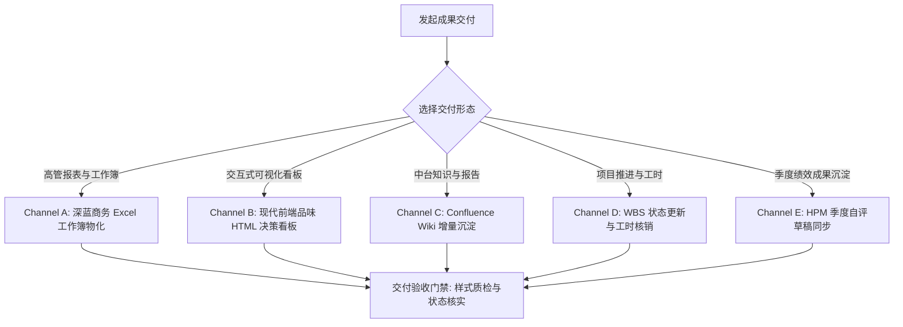

# 阶段五：结果交付与协同闭环 (Analytics Result Delivery)

负责数据分析成果的多渠道物化、可视化呈现与协同闭环。涵盖高管 Excel 工作簿、基于前端设计规范（`design-taste-frontend`）的交互式 HTML 看板、Confluence Wiki 知识沉淀、WBS 进度回写与工时闭环。

## 核心主导词 (Leading Words)

- **`【高管工作簿 / executive-excel】`**：Excel 交付达到直接呈报标准（深蓝底白字表头居中、自适应列宽、数值带千分位、比率严格应用百分比格式）。
- **`【设计品味 / design-taste-html】`**：利用 HTML/现代前端规范呈现分析报告，遵循“总-分-总”结构，背景、结论、过程数据证据链完备，排版考究、层次分明、拒绝模板化。
- **`【知识增量 / wiki-sync】`**：Wiki 文档发布遵循增量版本追加原则，保持历史版本与附件完整。
- **`【工时与协同 / timesheet-audit】`**：工时填报与需求结单基于真实 Git 提交与需求编号交叉比对，整周工时严格守恒。
- **`【双模交付与用语净化 / dual-delivery-clean】`**：交付成果保持 Markdown 报告与高管 HTML 看板双模落盘；正文严格执行业务用语净化，全面替换技术黑话（如“延米”改用“陈列架长度”）。
---

## 内部资产引用 (Internal Assets)

- **交付方案融合与规范手册**：[references/DELIVERY_SYNTHESIS_REFERENCE.md](references/DELIVERY_SYNTHESIS_REFERENCE.md)
- **桑基图流转计算与渲染引擎**：`scripts/sankey_engine.py`（8大流向分类、Ledger守恒校验与SVG/HTML渲染）
- **桑基图视觉与样式契约**：[references/sankey_style_contract.md](references/sankey_style_contract.md)
- **桑基图标准文案模板**：[references/sankey_wording_templates.md](references/sankey_wording_templates.md)
- **交付报告通用模板**：[templates/delivery_report_template.md](templates/delivery_report_template.md)
- **黄金交付范例**：[examples/golden_delivery_report.md](examples/golden_delivery_report.md)
- **企业表格驱动脚本**：`scripts/wecom_sheet_driver.js`
- **统一门户驱动脚本**：`scripts/portal_browser_sync.js`
- **表格协同操作规约**：[references/wecom_sheet_patterns.md](references/wecom_sheet_patterns.md)
- **绩效自评标准规约**：[references/hpm_criteria.md](references/hpm_criteria.md)
- **关联工程规范**：融合新店 32 项体系（详见 [ps-new-store-benefit-report](../../product-strategy/ps-new-store-benefit-report/SKILL.md)）、加盟店前端 HTML 看板与桑基图（详见 [ps-franchise-store-report](../../product-strategy/ps-franchise-store-report/SKILL.md)）、O2O 卡片诊断（详见 [o2o-store-benefit-report](../../product-strategy/o2o-store-benefit-report/SKILL.md)）、统一门户同步（详见 [ps-portal-sync](../../product-strategy/ps-portal-sync/SKILL.md)）、季度绩效自评（详见 [hpm-performance-review](../../product-strategy/hpm-performance-review/SKILL.md)）与视频汇报（详见 [web-video-presentation-delivery](../../product-strategy/web-video-presentation-delivery/SKILL.md)）
---

## 5 大交付形态 (Delivery Channels)

### Channel A: 高管 Excel 工作簿物化 (Executive Excel)
1. 结构组织采用金字塔架构（Sheet 1 汇总指标卡片，Sheet 2 分省/分类明细，Sheet 3 口径说明与指标数据字典）；
2. 样式规范：深蓝底白字居中表头，自适应列宽无 `###`，金额千分位，比率百分比。

### Channel B: 现代前端品味 HTML 决策看板与桑基流图 (Interactive HTML Dashboard & Sankey)
1. **决策看板结构设计**：遵循“总-分-总”叙事架构：
   - 顶层总括：背景契机与核心定性结论；
   - 中层过程分拆：全链路流转漏斗、单品品效对决矩阵、同周期大盘均线对比；
   - 底层行动闭环：具体业务改进建议（保供、清退、前置管控）。
2. **加盟店桑基图自动承接 (Sankey Flow Integration)**：
   针对加盟店组货流转与品数分类动态变化，调用内置 `scripts/sankey_engine.py` 工具：
   - 自动生成 8 大标准流向（稳定目录内/外、流转转入/出、新增、汰换）；
   - 自动执行 Ledger 守恒闭环校验（源端流出总额 == 终端流入总额）；
   - 生成高保真矢量 SVG 与交互式 HTML 流图，嵌入报告。
- 建立严谨的字体层级与排版呼吸感，保持一致的中性调色盘（Zinc/Slate/Paper）；
- 交互看板采用原生 SVG ViewBox 矢量缩放（平移缩放无损锐利，告别光栅化模糊）；
- 侧边栏内建双向拖拽分栏（`#resizer`，支持 300px~950px 自由拉伸），图例按核心品类色系收敛合并；
- 图元点击与清单表格实现双向互锁联动定位。
### Channel C: Confluence Wiki 增量沉淀 (Wiki Publishing)
提取方案与结论，在正文末尾追加修订记录，增量更新知识库页面。

### Channel D: WBS 推进表结单与工时核销 (WBS & Timesheet)
通过驱动工具将需求流转为已完成，并核验工时守恒记录至工时系统。

### Channel E: HPM 绩效成果沉淀 (Performance Self-Review)
从专题交付中提取客观成果证据，编写务实工程自评草稿。

---

## 交付步骤与完成标准 (Steps & Completion Criteria)

1. **Step 1：物化结构化交付报告**：
   在 `<project>/05_delivery/md/demand-<ID>-05-delivery.md` 生成符合模板的完备报告，严格执行业务用语净化（去黑话）。
2. **Step 2：物化交互式 HTML 诊断看板**：
   在 `<project>/05_delivery/demand-<ID>-05-delivery.html`（或 `04_outputs/`）输出基于 `am render` 的交互式 HTML 看板文件，支持在浏览器中直接打开检视。
3. **Step 3：外部数据湖与边界核验**：
   确认全量数据已接入数据湖，运行数据边界检查确保通过。

**完成标准**：交付文档规范落盘，数据湖边界校验通过，完成协同系统状态回写。
