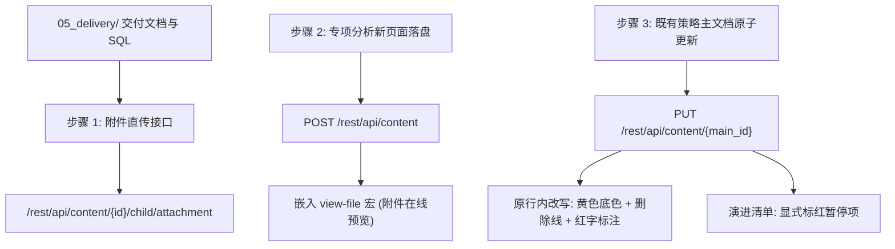

# Confluence 6.x Wiki 增量发布与规范契约 (Wiki Publishing Contract)

本手册规定分析交付成果向企业 Confluence Wiki（6.x）发布、更新与归档的标准协议。

## 核心主导词 (Leading Words)

- **`【Wiki 权威沉淀 / wiki-publishing-contract】`**：成果发布以 REST API（`wiki-rest-first`）读写存储源码为唯一真源，杜绝界面富文本编辑造成的结构撕裂。
- **`【原行内改写与高亮契约 / inline-highlight-contract】`**：长期维护的主文档（如目录规则、策略步骤表），严禁私自新增行打乱顺序；必须在原版本行内就地改写，整行应用黄色底色高亮，废弃规则加删除线，新增/变更规则加红色字体。
- **`【附件宏免下载预览 / attachment-view-macro】`**：代码交接文档（Markdown/SQL）必须上传为页面底层附件，并在正文嵌入 `<ac:structured-macro ac:name="view-file">` 宏，实现技术人员免下载在线直接预览。
- **`【用语去口语化与边界防漂移 / professional-wording-boundary】`**：交付文档严格遵循技术客观表达，严禁出现口语化隐喻（如「温水煮青蛙」）；严格排除跨需求无关事项（如未进入当期改造的大盘考核口径）。

---

## 交付三层架构 (Three-Tier Publishing Architecture)



---

## 1. 专项分析新页面创建规范 (New Dedicated Page)

当期需求存在独立测算表、效益矩阵与技术交接规范时，必须在指定父页面下创建独立专项页面：

- **父页面归属**：查询父页面 ID（如智能组货归属于 `86560179` 智能组货-策略分析），确保与历史专项页面（如 `96220238` 季节性商品项目）同级；
- **页面标题命名**：`【专题名称】Demand-<id> <需求名称>分析与交付说明`；
- **接口请求**：
  ```http
  POST /rest/api/content
  Content-Type: application/json
  X-Atlassian-Token: nocheck

  {
    "type": "page",
    "title": "【智能组货】Demand-32014a TOP品种补全模型优化分析与交付说明",
    "space": { "key": "XXSJGLB" },
    "ancestors": [{ "id": "86560179" }],
    "body": {
      "storage": {
        "value": "<h2>一、需求背景</h2>...",
        "representation": "storage"
      }
    }
  }
  ```

---

## 2. 交付文档附件直传与 view-file 宏规范 (Attachment & Macro)

将 Markdown 格式的技术交接文档（如 `05-development-handoff.md`）或生产 SQL 上传为附件并在正文嵌入宏：

### 2.1 附件上传接口
- **端点**：`POST /rest/api/content/${pageId}/child/attachment`
- **请求体**：`multipart/form-data`（包含 `file` 与可选的 `comment` 说明）；
- **免下载直传**：通过浏览器页面上下文执行 `fetch`，避免 Base64 通道截断。

### 2.2 正文嵌入 view-file 宏模板
在正文小节追加宏代码，指定附件文件名与展示高度：
```html
<h2>技术开发交接文档</h2>
<p>以下为技术团队开发交接文档（在线预览）：</p>
<p>
  <ac:structured-macro ac:name="view-file" ac:schema-version="1">
    <ac:parameter ac:name="name">
      <ri:attachment ri:filename="demand-32014a-smart_assortment-2026102914-05-development-handoff.md" />
    </ac:parameter>
    <ac:parameter ac:name="height">250</ac:parameter>
  </ac:structured-macro>
</p>
```

---

## 3. 策略主文档原行内改写与视觉规范 (Inline Highlight Contract)

对维护中的主文档（如 `128206125` 三合一目录 V8.0-策略逻辑），必须执行以下原子更新规范：

### 3.1 演进清单暂停/变更标注
在版本特性清单中，若某个子需求被业务叫停或变更，必须显式紧随标题后红字标注：
```html
<!-- 范例 -->
<li>自有品牌优化（Demand-31939b）<span style="color: rgb(255,0,0);">（暂停，业务需求变更）</span><ol>...</ol></li>
<li>医保占比<span style="color: rgb(255,0,0);">（暂停，业务需求变更）</span></li>
<li><a href="https://wiki.dslbuy.com/pages/viewpage.action?pageId=128214606">TOP 品优化（Demand-32014a：12月首发上线&lt;=TOP30，季度递进至TOP60）</a></li>
```

### 3.2 步骤表格原行内改写与高亮契约
- **禁止另起新行**：步骤表格有严格的顺序与上下文关系，新增版本不可另起新 TR，必须就地改写原有行；
- **整行黄色底色高亮**：该行所有 `<td>` 必须统一应用黄色高亮样式：
  `class="highlight-yellow" data-highlight-colour="yellow" style="background-color: rgb(255,255,204);"`；
- **版本列追加**：`<td>V3.0，V4.0，<span style="color: rgb(255,0,0);"><strong>V8.0 (2026Q4优化)</strong></span></td>`；
- **废弃规则删除线**：原逻辑被替代处，使用 `<s>...</s>` 标记原文本；
- **新增/变更规则红色高亮**：新逻辑使用 `<span style="color: rgb(255,0,0);"><strong>...</strong></span>` 显式呈现；
- **挂载专项链接**：在说明列末尾增加指向专项新页面的超链接。

---

## 4. 业务用语规范与边界防漂移 (Wording & Boundary)

1. **禁用口语隐喻**：
   - 严禁在正式 Wiki 页面使用「温水煮青蛙」、「放水」等俚语或口头沟通词汇；
   - 统一替换为「分步实施策略」、「分阶段逐步推进」等规范工程技术用语。
2. **严格防范需求边界扩散**：
   - 评审会议纪要中常包含与本需求并行的全局讨论（如全店动销率大盘剔除一致性、缺货门店库存扣减机制等）；
   - 编写 Wiki 时必须对照需求定义（01-demand），与当期模型改造逻辑无关的全局协同口径，严禁擅自并入专项模型规则，避免造成下游误解与责任扩散。
