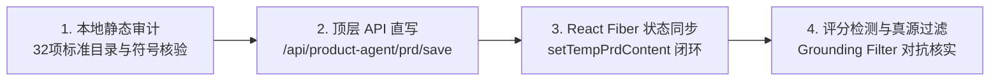

# 交互模式 D / E / F / G / H / I 详细参考

本文档是 `SKILL.md` 中「模式 D/E/F/G/H/I」摘要的展开说明。按需读取；SKILL.md 为路由入口。

---

## 模式 D: Vue/React 受控表单与动态文件注入 (Controlled Forms & File Injection)

针对现代前端框架（Vue 3 / React / Element UI / Ant Design / 腾讯文档表单）：

### D.1 受控组件文本写入

直接修改 `el.value = ...` 会被框架响应式拦截，导致失焦后值清空或校验失败。必须调用原型链原生 setter 并派发冒泡事件：

```javascript
const proto = el instanceof HTMLTextAreaElement
  ? HTMLTextAreaElement.prototype
  : HTMLInputElement.prototype;
Object.getOwnPropertyDescriptor(proto, 'value').set.call(el, val);
el.dispatchEvent(new Event('input',  { bubbles: true }));
el.dispatchEvent(new Event('change', { bubbles: true }));
```

### D.2 动态文件上传注入

绕过系统文件选择弹窗，将本地文件经 Base64 转为内存 `File`，通过 `DataTransfer` 注入隐藏或动态生成的 `input[type=file]`：

```javascript
const dt = new DataTransfer();
dt.items.add(new File([byteArray], fileName, { type: mimeType }));
input.files = dt.files;
input.dispatchEvent(new Event('input',  { bubbles: true }));
input.dispatchEvent(new Event('change', { bubbles: true }));
```

标准工具实现已沉淀在 `scripts/form_injector.mjs`，可直接跨仓库复用。

### D.3 动态 input 触发时序

部分上传组件初始 DOM 中不存在 `input[type=file]`；必须先点击「上传」容器触发组件渲染，等新 input 挂载后再注入。用 `document.querySelectorAll('input[type=file]')` 探活，长度从 0 变 1 后再注入。

### D.4 语义特征锚定定位（多 textarea 场景）

页面存在多个相似 textarea 时，**禁止**硬编码下标（如 `querySelectorAll('textarea')[2]`）。应向上遍历父节点文本特征（如「01 观点来源」标签），在其父容器内唯一定位目标 textarea。

---

## 模式 E: 多标签页并发槽位与 Four-Gate 生产防错门禁 (Multi-tab & Four-Gate Safety)

针对具有真实业务副作用（积分申报、工单提交、配置修改）的自动化操作，必须实施确定性四重防错门禁：

| Gate | 名称 | 规则 |
|------|------|------|
| **Gate 1** | 显式槽位隔离 | 所有 CDP / huashu-chrome 指令显式携带 `tabId`（`client.call(cmd, { tabId, ... })`），禁止依赖隐式缺省槽，防止多 Agent 会话并发串台。 |
| **Gate 2** | 语义卡片与标题强断言 | 操作前后严格断言目标卡片文本与弹窗标题（如 `.el-dialog__title`），未命中立即熔断中断，绝不盲操作。 |
| **Gate 3** | 单实例防重校验 | 上传附件前清空旧列表，注入后强校验 DOM 渲染列表项长度必须严格为 1（`document.querySelectorAll('.el-upload-list__item').length === 1`）。 |
| **Gate 4** | 人机终审交接 (Human-in-the-Loop) | 自动化只负责完整填写表单并保持弹窗展开态，严禁脚本点击提交按钮，最终确认交由人工终审执行。 |

---

## 模式 F: 顶层环境 REST 直写与附件透传 (Top-Frame REST & Attachment Ingestion)

针对具备 REST/RPC 接口的系统（如 Confluence 6.x、GitLab、Jira、企业知识库）：

### F.1 顶层原生 fetch 穿透

当页面存在跨域 iframe 导致 `eval` 抛出 `Cannot access contents of the page` 权限错误时，改用：

```javascript
client.call("fetch", { url, init }, { tabId })
```

仅在顶层 frame 上下文执行原生 `fetch`，自动复用当前站点的 Cookie 与 SSO 会话，完全穿透权限壁垒。

根因：`eval` 指令底层默认执行 `allFrames: true` 注入脚本，当页面内嵌第三方或跨域 iframe 时触发扩展宿主权限拦截。

### F.2 二进制/文档附件透传

通过在页面上下文组装 `FormData` 并 POST 目标上传端点（如 `/rest/api/content/${pageId}/child/attachment`），免下载落地直传大附件，避免 base64 内存膨胀与字符截断。

### F.3 标准工具实现

顶层请求与附件直传能力已封装在 `scripts/huashu_driver.mjs`：

- `callTopFetch(client, { tabId, url, method, headers, body })` — 顶层 fetch 穿透。
- `uploadAttachmentToPage(client, { tabId, pageId, filePath, mimeType })` — 附件直传端点。


---

## 模式 G: 测试工作台用例批量执行与阶段流转自动化 (Test Workbench Batch Execution & Stage Transition)

针对 QA 测试工作台（如 `next.dslbuy.com` 等用例执行面板）的批量自动化执行、状态推进与阶段门禁流转。

### G.1 动效与遮罩防护 (mask-guard)

用例卡片切换与详情渲染时常伴有 ElementUI `el-loading-mask` 渐隐动效（~200-300ms）。在此期间如果直接调用坐标点击，会被遮罩拦截报 `[NOT_INTERACTABLE]`。
防护策略：
1. 优先调用 `.result-btn.passed-btn.click()` 触发原生事件。
2. 遮罩判定用 `getComputedStyle` + 尺寸：`!/fade-leave/.test(className) && display≠none && visibility≠hidden && 宽高>0`。**不要**用 `:not([style*="display: none"])`——页面会残留带 `el-loading-fade-leave` 的遮罩且无 inline style，导致永远判为「有遮罩」而空转（2026-11 Story-288904 实测）。
3. 循环自带停滞熔断（`stallLimit`，默认 10 步 passed 不增长则返回 `reason: "stalled"`），避免空转到 maxSteps。

### G.2 宿主外层紧凑驱动循环 (tight-loop vs 30s timeout)

huashu-chrome 扩展对单次 `eval` 命令有约 30s 响应时限。**严禁在 Chrome 页面内部写大循环 `await sleep(...)`**，否则必报 `扩展 32s 未响应 (TIMEOUT)`。
必须由 Node.js 宿主脚本驱动外层步进循环：单步在 Chrome 内执行轻量原子同步 eval，每步间隔 300~400ms，在外部掌控全局超时与进度回调。

### G.3 末尾用例失焦补偿 (tail-compensation)

测试工作台通常在点击「通过」后自动将详情面板切换到下一个 `pending` 用例；但在跳至列表最后一条，或网络卡顿导致失焦时，右侧详情区不会载入「通过」按钮。
补偿策略：每轮先检测详情区是否存在 `.result-btn.passed-btn`，若不存在则主动执行 `pendingCards[0].click()` 显式选中激活。

### G.4 阶段用例动态扩增 (stage-expansion)

平台通常分阶段控制用例曝光：冒烟阶段仅展示 P0 用例（如 26 条）；冒烟确认流转至系统测试阶段后，底层重新注入全量用例（如扩增至 49 条）。
处理策略：
1. 第一阶段推进直到 `pending === 0`，底部「冒烟通过」按钮由 `is-disabled` 变为点亮。
2. 阶段流转完成后，重新获取用例列表（`cards.length`），进入第二阶段推进。

### G.5 流程终审流转门禁 (human-gate)

阶段流转（冒烟通过、完成测试）会导致工单流转、邮件通知与测试报告生成，具有业务副作用。
必须严格执行 Four-Gate 规范：
1. 自动化负责把所有待执行用例批量通过，直到流转按钮点亮。
2. 阶段流转按钮（`冒烟通过` / `完成测试`）及模态确认弹窗须在获得人机终审授权后，通过 `confirmStageTransition` 触发。动作按钮在 `.bottom-smoke-actions` 内按 `STAGE_ACTIONS` 匹配；确认按钮按结构定位（弹窗主按钮），不硬编码「确认通过/确认完成」；弹窗正文必须包含触发按钮文案才点确认，否则自动取消并返回 `modal_text_mismatch`。确认后轮询 Story 状态标签 `.twf-status-tag` / 阶段按钮变化，未变化返回 `no_state_change_after_confirm`。

标准工具脚本已实现于 `scripts/test_case_runner.mjs`；页面改版时只改导出的 `SELECTORS`。CLI：`node test_case_runner.mjs <status|pass-all|confirm-stage> <tabId|Story-XXXX|URL> [actionText]`。

---

## 模式 H: 企业统一身份认证 SSO 自动登录 (Enterprise SSO Passport Login)

针对企业统一身份认证服务（如 `sso.dslbuy.com/login` 等 CAS / OAuth2 网关）的账号密码自动化填入与登录流转。

### H.1 凭据解耦与权限门禁 (credential-decoupling)

严禁在代码、日志或 Prompt 中硬编码或回显明文凭据。
1. 生产凭据存储在 `private/sso-tech-committee.env`，并软链接至家目录 `~/.sso-tech-committee.env`。
2. 文件权限必须严格设置为 `600`（仅当前用户只读），并通过 `./scripts/harden-secret-permissions.sh` 与 `make parent-privacy-audit` 门禁检查。

### H.2 同 ID 多表单靶向定位 (passport-form-target)

企业统一认证页经常在同一页面内同时挂载手机验证码登录（`loginWay=phone`）与工号/密码登录（`loginWay=passport`），且两个表单常共用同一 ID（如 `id="p_inP_login"`）。
如果使用 `document.querySelector("#p_inP_login")` 会默认命中第一个隐藏的手机登录表单，导致密码输入失效并报错“短信验证码已失效”。
靶向选择器：
```javascript
const passportInput = document.querySelector("input[name='loginWay'][value='passport']");
const form = passportInput.closest("form");
const uInput = form.querySelector("input[name='username']");
const pInput = form.querySelector("input[name='password']");
```

### H.3 原生 Setter 注入与受控事件冒泡 (controlled-setter)

密码输入框被前端表单组件拦截时，直接赋值 `el.value = ...` 不会触发双向绑定。
必须通过原型链 setter 注入，并派发原生事件：
```javascript
const proto = HTMLInputElement.prototype;
const setter = Object.getOwnPropertyDescriptor(proto, 'value')?.set;
setter ? setter.call(el, val) : (el.value = val);
el.dispatchEvent(new Event('input', { bubbles: true }));
el.dispatchEvent(new Event('change', { bubbles: true }));
```
在派发完整事件的前提下，表单提交通常能正常通过基础风控校验，避免拉起滑动验证码浮层。

### H.4 重定向判定与轮询结算 (redirect-settle)

点击 `.login-content__form-submit` 后，页面需与 SSO 服务端通信并经过 302 跨域重定向回源业务系统。
Node 驱动层使用短间隔（800ms）轮询 `snapshot`，当页面的 URL 判定离开 `sso.dslbuy.com/login` 且进入目标业务域时，判定登录成功。

### H.5 标准工具实现

标准实现在 `scripts/sso_login.mjs`：
```bash
# CLI 调用示例
node ~/.agents/skills/huashu-jev-automation/scripts/sso_login.mjs <tabId>
```
完整函数签名与示例见 `scripts/huashu_driver.mjs`。

---

## 模式 I: AI 产品工作台 PRD 闭环直写与评分审计 (React-Fiber-Sync & Direct-API-Save)

针对企业级研发协同平台中的 AI 产品设计工作台（如 `ai-devops.dslbuy.com/#/prototype/Story-XXXXXX`），自动化推进 PRD 文档编写、质量检测修复与高分达标流转。

### I.1 交互痛点与架构成因

1. **富文本 DOM 虚假保存**：工作台使用 Vditor/富文本编辑器。仅修改 DOM 文本或 textarea 只影响浏览器临时渲染，点击保存或重新检测时，平台从底层 React 状态和云端 OSS 拉取旧快照计算，导致修改无法生效。
2. **Agent 长生成截断与超时**：通过聊天对话框指令生成完整 PRD 时，长文档（1.5万~2.5万字）极易在中间章节发生流式超时、代码块中断或截断遗漏。
3. **评分规则符号敏感**：平台的 32 项字段解析器使用严格的正则匹配。例如只匹配全角中文括号 `### 边界场景（edge_cases）`，若输入英文半角括号 `### 边界场景 (edge_cases)` 会被直接判定为“未填写”扣除 10 分。
4. **评分建议的业务失真陷阱**：通用大模型评审器常机械套用 Web 交互规范，对离线数仓/算法类需求提出“补充人工导入界面”、“强制全量门店产出退货”等破坏性建议，盲目迎合会导致业务逻辑报废。

### I.2 核心操作四步法 (The 4-Step Pipeline)



#### 步骤 1: 32 项标准字段静态审计 (Pre-flight Audit)
在提交前通过脚本扫描 Markdown 标题，断言 32 项必填项 100% 存在，强制要求以下正向规范：
- `### 量化目标（baseline→target）`（包含基线与度量口径，禁止简写为“量化目标”）
- `### 边界场景（edge_cases）`（必须使用中文全角括号）
- `### 每个功能的详细说明` 下包含的 `#### N.` 序号与子功能名称必须与 `### 功能点列表` 保持 1-to-1 完整映射。
- 删除任何包含“示例”、“依契约”、“待定”等模糊占位字眼，避免触发分析器质量扣分。

#### 步骤 2: 顶层持久化直写 (Direct-API-Save)
绕过低效的富文本输入，直接在页面顶层执行带有会话 Token 的原生接口持久化：
```javascript
const savePayload = {
  prd_id: String(prdId),
  content: markdownContent,
  created_by: username,
  version: currentVersion + 1
};
await fetch("/api/product-agent/prd/save", {
  method: "POST",
  headers: {
    "Content-Type": "application/json",
    "Authorization": "Bearer " + token,
    "Agent-Token": token,
    "Devops-Platform-Token": devopsToken
  },
  body: JSON.stringify(savePayload)
});
```

#### 步骤 3: React Fiber 状态探针同步 (Fiber-Sync)
从 `.vditor` 容器向上遍历 Fiber 节点，提取 `onSavePrd` 所属组件，同步更新 `setTempPrdContent`：
```javascript
const el = document.querySelector(".vditor");
const k = Object.keys(el).find(k => k.startsWith("__reactFiber"));
let fiber = el[k];
while (fiber) {
  if (typeof fiber.memoizedProps?.setTempPrdContent === "function") {
    fiber.memoizedProps.setTempPrdContent(markdownContent);
    break;
  }
  fiber = fiber.return;
}
```

#### 步骤 4: 重新检测与真源对账过滤 (Grounding Filter)
触发重新检测按钮绑定的 React `onClick` 事件，以 3 秒间隔轮询综合评分、结构分与质量分。

**真实证据过滤法则 (Grounding Filter)**：
- 评审器要求“缺少交互界面/上传接口”时：在 PRD 不做范围（Non-Goals）中显式写明“本期为纯离线数仓算子工作流，不提供 Web 交互与上传”，以规范正文消除扣分，严禁虚构未规划的接口；
- 评审器要求“产出结果门店数必须等于全量在营门店数”时：坚持业务门禁，在验收标准中给出“门店类型覆盖全集”与“范围差集守恒”的检验 SQL，禁止强行放开退货门禁导致业务误退。

### I.3 标准工具实现

完整能力封装在 `scripts/prd_workbench.mjs`。命令清单与参数以脚本自身为唯一真源，不在此重复：
```bash
node ~/.agents/skills/huashu-jev-automation/scripts/prd_workbench.mjs --help
```
评分死锁与迭代闭环详见 `references/score-iteration-loop.md`。

