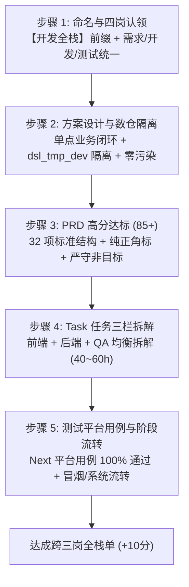

# 全栈单流转与效能平台 Story 规范化操作规程 (Full-Stack Story Standardization SOP)

> 沉淀日期：2026-11-09
> 标杆案例：`Story-279258`（慢病、统筹店营增加组群划分 - 营运区热销组群划分·上海）
> 适用范围：科技门户 AI 排行榜全栈申报、效能平台（`self.analysis.dslyy.com` / `devops.dslbuy.com`）全栈 Story 规范化推进

---

## 一、全栈积分与评级规则基准（科技门户 SSOT）

| 规则项 | 关键参数 / 门禁 | 说明 |
|---|---|---|
| **每单分值** | 跨三岗 **+10分**；跨二岗 **+8分** | 跨三岗要求覆盖：**需求负责人 + 后端 + 前端 + 测试** 全部或三项核心链路 |
| **计分上限** | 单月最多计 **5 单**，最高 **50分/月** | 超出 5 单的部分仅累计“全栈总单数”，不计入当月积分总分 |
| **段位进阶** | 见习全栈（1单） $\to$ 全栈骑士（10单） | 每年按完成的全栈单数自动晋升 |
| **评审流程** | AI 自审 $\to$ 架构师评审 $\to$ 全栈委员会终审 | 必须具备完整 PRD（80+分）、任务分解、代码提交与测试用例闭环 |

---

## 二、全栈 Story 规范化「五步流水线」



### 1. 命名与角色四岗认领门禁 (Title & Role Gate)
* **标题命名**：所有拟申报全栈的 Story 标题必须以 `【开发全栈】` 开头（如 `【开发全栈】慢病、统筹店营增加组群划分 - ...`）。
* **角色归一**：在 DevOps / AI-DevOps 中，检查 Story 的四项核心角色：
  * **需求负责人**：必须为本人（或本组核心业务代表）；
  * **后端开发**：必须为本人；
  * **前端/交互开发**：必须为本人（含配置表单、报表或数据卡片）；
  * **测试验证**：必须为本人（含对账单测、自动化用例执行）。

### 2. 方案设计与数仓隔离门禁 (Engineering & Caliber Gate)
* **业务范围单一**：单 Story 聚焦单业务场景（如 Story-279258 严格限定上海 23 店，不与冀晋蒙/浙江混搭；Story-292798 严格聚焦缩铺算子与 SCM 联动）。
* **物理库隔离红线**：所有探针、测算、临时表统一写入开发临时库 `${dsl_tmp_dev}`，严禁写入生产 ADS 库造成资产污染；最终生产表延续既有调度契约。
* **对账双向差集为 0**：验收标准必须给出明确的同快照基准数据集定义，以及 `FULL OUTER JOIN` 差集为 0 的可观测 SQL。

### 3. PRD 高分直写与真源过滤 (PRD 85+ Gate)
* 使用 `scripts/prd_workbench.mjs` 工具：
  ```bash
  # 1. 静态检查 32 项目录与标点规范
  node ~/.agents/skills/huashu-jev-automation/scripts/prd_workbench.mjs audit <story_prd.md>
  # 2. 直写后端并保存
  node ~/.agents/skills/huashu-jev-automation/scripts/prd_workbench.mjs save --tabId <id> --file <story_prd.md>
  # 3. 触发检测并轮询分数
  node ~/.agents/skills/huashu-jev-automation/scripts/prd_workbench.mjs score --tabId <id>
  ```
* **三大格式铁律**：
  * 必须使用全角中文括号：`### 边界场景（edge_cases）`、`### 量化目标（baseline→target）`；
  * `### 每个功能的详细说明` 下的 `#### N.` 序号与子功能名称必须与 `### 功能点列表` 1-to-1 严格对应；
  * 数据模型中禁止出现“示例”、“依契约”、“待定”等模糊字样。
* **真源过滤 (Grounding Filter)**：对评审器提出的“补充 Web 上传界面/强制全量门店产出”等脱离实际的建议，在 Non-Goals 中申明边界，坚决不为提分捏造业务逻辑。

### 4. Task 任务三栏均衡拆解 (Task Decomposition Gate)
* 将每个 Story 拆解为细粒度 Task，打满三栏工时（总工时控制在 40h ~ 60h）：
  * **前端/交互 Task**：配置交互、页面展示、参数表单（约 8~16h）；
  * **后端/算子 Task**：数据接入、准入门禁、计算引擎与结果落盘（约 20~30h）；
  * **QA/对账 Task**：基准对账脚本、边界压力测试、异常隔离断言（约 12~16h）。

### 5. 测试平台与自动化流转 (QA Workbench Gate)
* 进入 Next 测试平台（`next.dslbuy.com`），使用 `scripts/test_case_runner.mjs`：
  * 紧凑循环批量执行测试用例（避开 30s 扩展超时）；
  * 遮罩等待与末尾补偿；
  * 推进冒烟测试（P0）通过与系统测试通过，完成阶段流转确认。

---

## 三、效能平台（`self.analysis.dslyy.com`）待办排查与推进梯队

根据效能平台「我的待办 / 我的事项」实时排查结果，当前在手 4 个核心 Story 的规范化推进顺序：

| 梯队 | Story 标题 | 内部需求 | 状态 | 规范化改造动作 | 预期收益 |
|---|---|---|---|---|---|
| **第一梯队 (现货)** | 【开发全栈】组货复盘后模型调优 - 补充主推模型商品池适配优化 | Demand-32014b<br/>(Story-288905) | 已排期 (待研发) | 1. 挂载已完成的 83.1 分 PRD；<br/>2. 补齐前端/后端/QA三栏 Task；<br/>3. 运行自动化测试用例提测。 | **跨三岗 (+10分)**<br/>11月第2单 |
| **第二梯队 (同源复用)** | 【开发全栈】慢病、统筹店营增加组群划分 - 自有品牌模型2剔除逻辑 | Demand-31939b<br/>(Story-279259) | 已排期 (待研发) | 1. 复用 Story-279258 对账模板与技术方案；<br/>2. 生成标准 32 项 PRD；<br/>3. 四岗承接人统一。 | **跨三岗 (+10分)**<br/>11月第3单 |
| **第三梯队 (补齐命名)** | 组货商品进入商品池前增加【货源仓禁发】过滤条件 | Demand-31957 | 已排期 | 1. 标题补前缀 `【开发全栈】`；<br/>2. 角色四岗认领为本人；<br/>3. 补充三栏 Task 分解。 | **跨三岗 (+10分)**<br/>11月第4单 |
| **第四梯队 (验证结单)** | 商品决策增加新品agent后台配置 | Demand-31955 | 验证中 | 1. 检查承接角色是否满足跨岗；<br/>2. 推进测试平台验证完成结单。 | **跨二/三岗 (+8~10分)**<br/>11月打满 50分 上限 |
